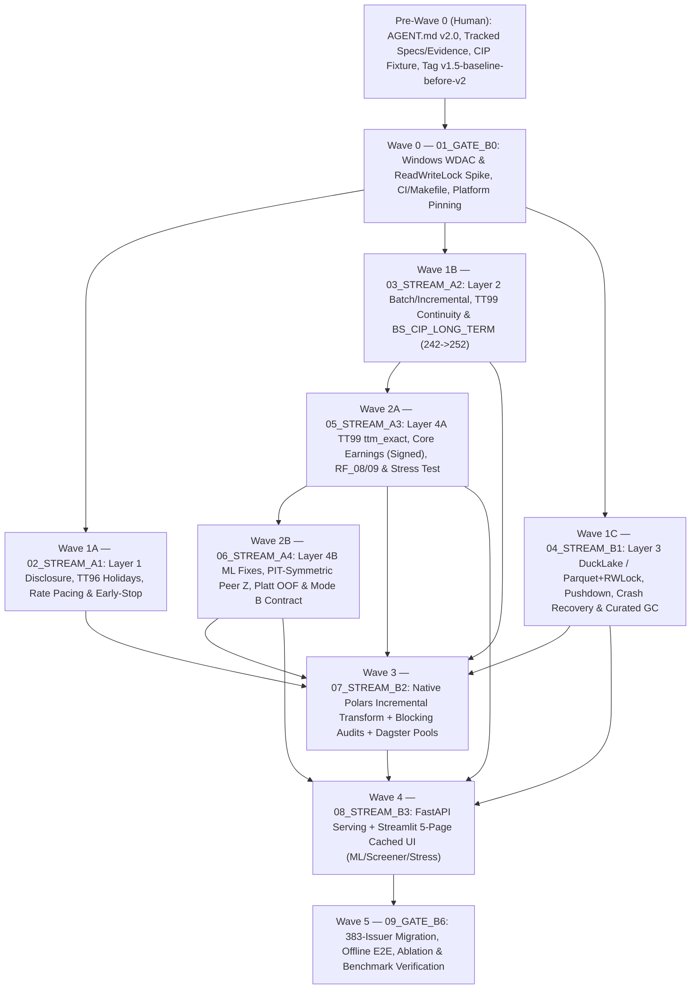

# CHƯƠNG TRÌNH TỔNG THỂ V2 & QUY CHẾ PHỐI HỢP ĐA AGENT (`finintel` SCALE-UP + FORENSIC & ML UPGRADE)

* **Mã chương trình:** `PROG-V2-MASTER-v1.1` *(Đã hiệu đính sau Kiểm toán Độc lập Pre-Implementation Audit & Independent Adversarial Review)*
* **Ngày cập nhật:** `2026-11-20`
* **Tài liệu nguồn được đối chiếu:**
  1. Hiến pháp dự án: `AGENT.md` & `docs/00_ENGINEERING_STANDARDS_AND_SPIKE.md`
  2. Đặc tả các tầng lõi: `docs/layers/LAYER_0_ORCHESTRATION.md` $\rightarrow$ `docs/layers/LAYER_5_6_SERVING_AND_QUALITY.md`
  3. Mục tiêu khắc phục điểm nghẽn quy mô (`383–1,600+` doanh nghiệp phi tài chính) và 7 lỗ hổng nghiệp vụ Tầng 4 còn tồn đọng (`GAP-02..GAP-08`, sau khi `GAP-01` đã vá tại `src/finintel/pipeline/analytics.py`).
* **Quyết định Kiến trúc Cốt lõi V2 (Sau Adversarial Review — Chống Phình Hệ thống):**
  1. **Một Động cơ Xử lý Duy nhất (`Single Authoritative Pipeline` — đóng `SEAM-04` & `MISS-05`):** Thay thế hoàn toàn ý tưởng chèn `SQLMesh` (gây 6 lỗi tích hợp `BLK-19` và xung đột `state_connection: sqlite` `MISS-03`) bằng **Native Polars Incremental Transform & Blocking Audit Engine (`src/finintel/transform/`)** dùng chung cho cả **CLI chính thức** và **Dagster Local Partitioned Assets**. Cả hai cùng đăng ký run hợp lệ trong `state.sqlite` và tuần tự hóa ghi qua `pipeline.lock` $\implies$ **0 split-brain**, **0 copy-paste công thức VAS/ML**.
  2. **Lưu trữ Hai Chế độ Sạch (Loại bỏ `delta-rs` — đóng `BLK-11`):** Chế độ chính là **`DuckLake` (`SQLite` catalog $\rightarrow$ `PostgreSQL` đa máy)** nếu Gate B0 vượt qua Windows WDAC & kiểm tra đa tiến trình; nếu WDAC chặn `.duckdb_extension` (hoặc CI ngoại tuyến không cho tải extension lúc chạy), **lùi thẳng về nhánh đã có là Sorted Parquet + `filelock.ReadWriteLock`** (`filelock==4.2.10` đã cài và đã vá lỗ hổng Windows side-file) — **không cài `deltalake`**.
  3. **Mode B `REGULATORY_DISTRESS` (Đóng `BLK-17`):** Được khóa chặt ở phạm vi **hợp đồng thư viện ngoại tuyến đã kiểm thử (`offline library contract`)** nhận bảng `regulatory_events` từ ngoài, **không** xây trình cào HTML sàn giao dịch trong Phase V2.
  4. **Chống Nhầm lẫn ICB Lịch sử (Đóng `BLK-16`):** Tuyệt đối **KHÔNG** coi phân loại ngành ICB hiện tại (`industry_snapshot_date = 2025/2026`) là chân lý lịch sử năm `2018–2023`; mô hình ML phải giữ đối xứng cohort Point-in-Time giữa `train`, `validation`, `test` và `scoring`.

---

## 1. LỆNH PHONG TỎA AN TOÀN VẬN HÀNH & NGHI THỨC TIỀN-WAVE 0 (`PRE-WAVE 0 HUMAN GATE`)

### 1.1. Bảo vệ Tuyệt đối Phiên Thu thập Dữ liệu Sống `ed48af80` (`task-748`)
Trong lúc phiên thu thập ~383 doanh nghiệp phi tài chính tại kho gốc vẫn còn hoạt động (hoặc chưa được chủ sở hữu xác nhận dừng hoàn toàn):
1. **CẤM ĐỤNG VÀO `data/live_fhsc_universe/`** (không đọc-ghi, không mở SQLite RW, không chạy test/migration vào thư mục này) cho đến khi chủ sở hữu dự án xác nhận phiên thu thập đã dừng 100%.
2. **CẤM GỌI FHSC OPEN API TRỰC TIẾP** trong lúc tiến trình nền đang dùng hạn mức `0.6 req/s`.
3. **CẤM CÀI ĐẶT / NÂNG CẤP GÓI VÀO `.venv` CHÍNH CỦA KHO GỐC** khi tiến trình Windows đang chạy; khi chạy Gate B0 song song, bắt buộc tạo môi trường ảo cô lập tại `%TEMP%\finintel-b0-spike-venv`.
4. **CẤM CHẠY CÁC LỆNH GIT PHÁ HỦY (`reset`, `stash`, `checkout`) TRÊN KHO GỐC** và **CẤM dùng đường dẫn tuyệt đối trỏ về kho gốc** trong mã nguồn/đặc tả — mọi đường dẫn phải là **repo-relative** (`src/...`, `config/...`, `tests/...`) để 100% an toàn trong `git worktree` độc lập.
5. **CẤM Coding Agent TỰ Ý SỬA `AGENT.md`**.

### 1.2. Nghi thức Khởi tạo Mốc Nền Sạch Bắt buộc (Con người thực hiện TRƯỚC Wave 0)
> [!IMPORTANT]
> Các hạng mục sau là **tiền điều kiện quản trị bắt buộc của chủ sở hữu dự án** trước khi tạo worktree Wave 0–5 (`BLK-01`, `BLK-03`, `MED-07`, `MED-08`):

1. **Chốt Hiến pháp `AGENT.md` v2.0 (hoặc ký Miễn trừ §4.2 — giải quyết `BLK-01` & `MED-08`):**
   * Phê duyệt tường minh nhóm thư viện Phase V2 `platform`: `fastapi`, `uvicorn`, `pydantic`, `httpx==0.28.1`, `dagster`, `dagster-webserver`, `dagster-duckdb` (ghi nhận `sqlalchemy` chỉ là transitive dependency của `dagster`, **cấm** import trực tiếp `sqlalchemy` trong `src/finintel/`!), cùng điều kiện tải `ducklake`/`sqlite` extension theo kết quả Gate B0. **Vẫn CẤM** `deltalake`, `sqlmesh`, `pyspark`, `apache-airflow`, `celery`, `pyiceberg`, `great-expectations`, `soda-core`, `ledgerlens`, `mlflow`, `torch`, `tensorflow`, `orjson`.
   * Làm rõ Điều răn §5.9 của `AGENT.md`: lệnh cấm per-row Pydantic model áp dụng cho **ETL/Analytics bảng lớn**, còn tầng Serving API được phép serialize Pydantic DTO trên các lát cắt đã phân trang (`limit <= 200`, `df.to_dicts()`, `0` vòng lặp `iter_rows()`).
2. **Gỡ chặn `.gitignore` cho Đặc tả & Bằng chứng Gate (`BLK-03`):**
   * Hiện tại `.gitignore` đang bỏ qua `/.venv/`, `/data/`, và `/report/`. Vì vậy `git worktree add` sẽ **không có** `docs/v2_specs/` cũng như không thể track `option_b_spike_report.json` hay báo cáo Gate B6 nếu nằm dưới `/data/` hoặc `/report/`.
   * **Hành động bắt buộc trước Wave 0 (con người thực hiện):** Hoặc di chuyển toàn bộ 10 đặc tả V2 sang `docs/v2_specs/` và đặt bằng chứng Gate B0/B6 tại `docs/evidence/option_b_spike_report.json` & `docs/evidence/V2_PLATFORM_BENCHMARK_VERIFICATION.md`, **HOẶC** bổ sung quy tắc ngoại lệ `!` tường minh trong `.gitignore`. *(Các đặc tả bên dưới sử dụng đường dẫn `docs/evidence/...` cho bằng chứng được track trong Git, đồng thời cho phép cấu hình đường dẫn tương ứng nếu dùng ngoại lệ `.gitignore`.)*
3. **Nạp sẵn Fixture Ẩn danh & Khung Cấu hình Chung (`HI-06`, `MED-09`, `SEAM-05`):**
   * Commit sẵn 1 mẫu JSON Bảng cân đối kế toán FHSC ẩn danh chứa trường Chi phí XDCB dở dang (Mã TT200 `242` / TT99 `252`) tại `tests/fixtures/raw_samples/fhsc_cip_sample.json` để Wave 1B chạy độc lập 100% trong worktree (không lệ thuộc thư mục untracked `data/live_fhsc_exact_pit/`).
   * Bổ sung sẵn các khối khóa rỗng/mặc định (`storage:`, `ingestion:`, `serving:`) trong `config/settings.yaml` ở commit nền để Wave 1A/1C/4 không tranh chấp sửa chung file.
4. **Đóng băng Tag Mốc Nền Bắt buộc (`MED-07`):**
   * Chạy xanh `ruff format --check`, `ruff check`, `mypy --strict`, `pytest -q` trên nhánh nền sạch, tạo nhánh tích hợp `v2/integration` và **bắt buộc gắn tag `v1.5-baseline-before-v2`** tại đúng commit SHA nền.
   * Mọi Coding Agent làm việc trên 1 `git worktree` tách biệt (`https://git-scm.com/docs/git-worktree`):
     ```powershell
     git worktree add ../finintel-wt-<stream> -b v2/<stream> v2/integration
     ```
   * Sau khi Agent hoàn thành nhánh và **Review Agent độc lập (`review-lead`)** trả `PASS`, chủ sở hữu thực hiện `git merge --no-ff` vào `v2/integration` và dọn worktree cũ (`git worktree remove`).

---

## 2. ĐỒ THỊ PHỤ THUỘC & LỊCH PHÂN CÔNG ĐA AGENT (`DEPENDENCY DAG & WAVE SCHEDULE`)

Các nhánh trong cùng Wave 1 (`02`, `03`, `04`) có **tập file sở hữu tách biệt 100% (`Disjoint File Ownership`)** nên có thể triển khai song song trên 3 `git worktree` riêng biệt mà **không cần chờ phiên `ed48af80` kết thúc** (chỉ Wave 5 cắt chuyển dữ liệu thật mới chờ `ed48af80`!).



---

## 3. MA TRẬN PHÂN QUYỀN SỞ HỮU FILE TUYỆT ĐỐI (`STRICT FILE-OWNERSHIP LOCK MATRIX`)

> **Quy tắc sắt:** Mỗi Agent **CHỈ ĐƯỢC PHÉP SỬA/TẠO** các file trong cột **Owned Files** của đúng đặc tả mình nhận. Mọi thay đổi ngoài danh sách `Owned Files` sẽ bị **REJECT NGAY LẬP TỨC** ở cổng Review.

| File Đặc tả | Wave | Nhánh Git (`worktree`) | Owned Files (Độc quyền sửa/tạo) | Contract Dependencies (Chỉ đọc) | Hạng mục Giải quyết |
|---|---|---|---|---|---|
| `01_GATE_B0_WDAC_SPIKE_AND_BASELINE_FREEZE.md` | **Wave 0** | `v2/b0-spike` | `scripts/spike_option_b.py`, `docs/evidence/option_b_spike_report.json`, `pyproject.toml` (chỉ thêm `[dependency-groups] platform`), `uv.lock`, `.github/workflows/ci.yml`, `Makefile` | `docs/00_ENGINEERING_STANDARDS_AND_SPIKE.md`, `AGENT.md` | Gate B0 WDAC + `ReadWriteLock` Windows subprocess Spike, sửa CI/Makefile, khóa gói `platform` |
| `02_STREAM_A1_LAYER1_DISCLOSURE_AND_TT96_CALENDAR.md` | **Wave 1A** *(Song song)* | `v2/a1-layer1` | `src/finintel/domain/schemas.py`, `src/finintel/ingestion/disclosure_enricher.py`, `src/finintel/ingestion/fhsc_oapi_adapter.py`, `src/finintel/pipeline/ingest.py`, `src/finintel/pipeline/state_store.py`, `tests/unit/test_layer1_ingestion.py`, `tests/unit/test_layer4_disclosure_enrichment.py` | `docs/layers/LAYER_1_INGESTION.md`, `src/finintel/ingestion/archive.py`, `src/finintel/pipeline/runner.py` | `GAP-07` (CafeF audit-tier-safe, lịch lễ VN 2016–2026, bảo toàn `audit_status` != `None`), `GAP-08` (opt-in schedule + enricher), `PRAGMA synchronous=NORMAL`, FHSC rate pacing (`0.6 req/s`) & `EARLY_STOPPED` |
| `03_STREAM_A2_LAYER2_BATCH_INCREMENTAL_AND_TT99_CONTINUITY.md` | **Wave 1B** *(Song song)* | `v2/a2-layer2` | `config/metric_definitions.yaml`, `config/taxonomy/corporate_tt200_2014.yaml`, `config/taxonomy/corporate_tt99_2025.yaml`, `src/finintel/normalization/mapper.py`, `src/finintel/normalization/archive.py`, `src/finintel/normalization/periods.py`, `src/finintel/pipeline/normalize.py`, `tests/unit/test_layer2_normalization.py`, `tests/unit/test_layer2_batch_incremental.py`, `tests/reconciliation/test_golden_ratios.py` *(CHỈ Case 3 `EDGE2`; CẤM sửa số liệu FPT 2024–2025!)* | `docs/layers/LAYER_2_NORMALIZATION.md`, `src/finintel/ingestion/hasher.py`, `tests/fixtures/raw_samples/fhsc_cip_sample.json` | Option B Chặng B1 (`map_batch`, lô 50 issuer, `.rechunk()`, JSON cache theo `raw_root`, `normalize_archive_incremental`), `GAP-02` Layer 2 (24+3 metrics, bridged sort/anti-join & `ttm_exact_filing`), `BS_CIP_LONG_TERM` (`242 -> 252`) |
| `04_STREAM_B1_LAYER3_DUCKLAKE_STORAGE_AND_CURATED_GC.md` | **Wave 1C** *(Song song)* | `v2/b1-layer3` | `config/settings.yaml` (khối `storage:`), `src/finintel/storage/__init__.py`, `src/finintel/storage/ducklake_store.py`, `src/finintel/storage/curated_gc.py`, `src/finintel/storage/repository.py`, `src/finintel/storage/snapshot_publisher.py`, `src/finintel/storage/manifest_export.py`, `src/finintel/pipeline/publish.py`, `src/finintel/pipeline/cli.py`, `tests/unit/test_layer3_storage.py`, `tests/unit/test_layer3_ducklake_storage.py` | `docs/evidence/option_b_spike_report.json`, `src/finintel/storage/schemas.py` | Option B Chặng B2 (`DuckLakeStore` hoặc `parquet` + `ReadWriteLock`, `SET SORTED BY`, `ducklake_snapshots` -> `versions` expiry, crash recovery + rollback, `snapshot_session(connection=...)`, SQLi-safe `read_table`, Curated GC hardened, 1× read) |
| `05_STREAM_A3_LAYER4A_FORENSIC_CORE_EARNINGS_AND_STRESS_TEST.md` | **Wave 2A** | `v2/a3-layer4a` | `src/finintel/storage/schemas.py` *(chỉ mở rộng additive)*, `src/finintel/analytics/intermediates.py`, `src/finintel/analytics/ratios.py`, `src/finintel/analytics/comparisons.py`, `src/finintel/analytics/red_flags.py`, `src/finintel/analytics/stress_test.py`, `src/finintel/analytics/tables.py`, `tests/unit/test_layer4_analytics.py`, `tests/unit/test_layer4_forensic_and_stress.py` | `03` đã merge, `tests/reconciliation/test_golden_ratios.py` | `GAP-02` (`ttm_exact_filing`), `GAP-04` (4Q `_exact_filing_basis`), `Core Earnings` (bảo toàn dấu `SIGNED_EXPENSE`, không `.abs()`), `FORENSIC_RATIOS` trong `comparisons.py`, `RF_08` & `RF_09`, `stress_test.py` + 5 cột scalar stress trong `schemas.py` |
| `06_STREAM_A4_LAYER4B_ML_REMEDIATION_SECTOR_ADJ_AND_REGULATORY_TARGET.md` | **Wave 2B** | `v2/a4-layer4b` | `src/finintel/ml/supervised/target.py`, `src/finintel/ml/supervised/temporal_split.py`, `src/finintel/ml/supervised/train.py`, `src/finintel/ml/supervised/explain.py`, `src/finintel/ml/unsupervised.py`, `src/finintel/ml/tables.py`, `src/finintel/pipeline/analytics.py`, `tests/unit/test_layer4_ml.py`, `tests/unit/test_layer4_ml_supervised.py` | `05` đã merge (`intermediates.py`, `comparisons.py`, `schemas.py`) | `GAP-02` (ML `QUARTER` trên TT200+TT99), `GAP-03` (4Q persistence không 7Q, indirect CF, optional `total_debt`), `GAP-04`, `GAP-05` (Platt OOF `raw_margin` + PIT-symmetric `sector_z_*` 4 biến), `GAP-06` (configurable `clip_range` + tên cụm duy nhất), Mode B offline library contract |
| `07_STREAM_B2_SQLMESH_AND_DAGSTER_PLATFORM.md` | **Wave 3** | `v2/b2-platform` | `config/dagster.yaml`, `src/finintel/transform/__init__.py`, `src/finintel/transform/incremental.py`, `src/finintel/transform/audits.py`, `src/finintel/orchestration/__init__.py`, `src/finintel/orchestration/partitions.py`, `src/finintel/orchestration/resources.py`, `src/finintel/orchestration/assets.py`, `src/finintel/orchestration/checks.py`, `src/finintel/orchestration/definitions.py`, `tests/unit/test_option_b_incremental_transform.py`, `tests/unit/test_option_b_dagster.py` | `02`, `03`, `04`, `05`, `06` đã merge | Native Polars Incremental Layer 4/6 (`dirty_issuers` + `dirty_period_end_dates`), Blocking QG1/QG2 Audits, Dagster Partitioned Assets (`concurrency.pools` riêng với rate limit, `deps=[raw_fhsc_filings]`, `data/metadata/dagster/`, single `StateStore` + `pipeline.lock`) |
| `08_STREAM_B3_LAYER5_FASTAPI_DASHBOARD_ML_SCREENER_STRESS_UI.md` | **Wave 4** | `v2/b3-serving` | `src/finintel/serving/__init__.py`, `src/finintel/serving/queries.py`, `src/finintel/serving/schemas.py`, `src/finintel/serving/dependencies.py`, `src/finintel/serving/api.py`, `dashboard/queries.py` *(thin re-export)*, `dashboard/client.py`, `dashboard/app.py`, `dashboard/components/charts.py`, `dashboard/components/widgets.py`, `dashboard/pages/1_company_profile.py`, `dashboard/pages/2_industry_comparison.py`, `dashboard/pages/3_audit_and_quality.py`, `dashboard/pages/4_forensic_screener.py`, `dashboard/pages/5_stress_testing.py`, `tests/unit/test_layer5_fastapi_serving.py`, `tests/integration/test_end_to_end_slice.py` | `04`, `05`, `06`, `07` đã merge | FastAPI (`:memory:` + `ATTACH READ_ONLY`, sync `def` cursor, `snapshot_session(connection)`, RFC 9110 `ETag`/`304`, hardening) + Streamlit 5-page cached UI (TreeSHAP Waterfall có `other_features_delta`, Peer Band History, 38/38 Lineage, Honest Screener, Stress Test UI) |
| `09_GATE_B6_UNIVERSE_MIGRATION_E2E_AND_BENCHMARK_VERIFICATION.md` | **Wave 5** *(Cổng Cuối)* | `v2/b6-verify` | `scripts/migrate_universe_to_v2.py`, `tests/integration/test_option_b_e2e_platform.py`, `docs/evidence/V2_PLATFORM_BENCHMARK_VERIFICATION.md` | **CHỈ CHẠY CẮT CHUYỂN KHI `ed48af80` XONG 100%** + `01..08` đã merge | Di cư chỉ-đọc WAL-safe ~383 mã thật + rollback test, Offline E2E (10 routes + circuit breaker + Mode B), Ablation & Benchmark đo thật 100% + Nghiệm thu cuối bởi `review-lead` |

---

## 4. PHẠM VI TỪ CHỐI TUYỆT ĐỐI (`OUT-OF-SCOPE / ANTI-BLOAT BOUNDARY FOR V2`)

Mọi Coding Agent **BỊ CẤM** tự ý thêm code hoặc dependency cho các hạng mục sau trong Phase V2:
1. **Không dùng `SQLMesh` và không dùng `delta-rs` (`deltalake`):** Đã bị loại khỏi V2 sau Adversarial Review (`BLK-11`, `BLK-19`, `MISS-03`, `MISS-05`) vì thừa hạ tầng, xung đột `state_connection: sqlite`, không tương thích tự nhiên với các hàm Polars trung gian của Tầng 4, và tạo rủi ro vận hành vượt quá quy mô 1 nút (`~10–40 MB` Parquet).
2. **Không xây trình cào HTML sự kiện sàn giao dịch (HOSE/HNX) cho Mode B:** Mode B (`REGULATORY_DISTRESS`) chỉ triển khai hợp đồng thư viện ngoại tuyến đã kiểm thử (`06_STREAM_A4`).
3. **Không làm Ngân hàng / Chứng khoán / Bảo hiểm Taxonomy (`TT49/2014`, `TT210/2014`, `TT232/2012`):** Chuyển sang Phase V3 sau khi hoàn tất V2 trên tập ~383 doanh nghiệp phi tài chính.
4. **Không thêm LLM / RAG / Chatbot / News Scraping / Deep Learning dự báo giá** (`torch`, `tensorflow`, `langchain`, `openai`, `beautifulsoup4`, `playwright`, `scrapy`).
5. **Không cài thư viện ngoài danh sách `platform` đã phê duyệt ở Gate B0:** Cấm `pyspark`, `apache-airflow`, `celery`, `pyiceberg`, `great-expectations`, `soda-core`, `ledgerlens`, `mlflow`, `orjson`, `rapidfuzz`, và cấm import trực tiếp `sqlalchemy` trong `src/finintel/`.

---

## 5. CỔNG CHỐNG CODE RÁC & QUY TRÌNH REVIEW BẮT BUỘC (`ZERO-JUNK-CODE MERGE GATE`)

Mỗi nhánh `v2/<stream>` trước khi được merge vào `v2/integration` **PHẢI VƯỢT QUA 100% CẢ 7 CHỐT KIỂM ĐỊNH SAU** (được xác minh độc lập bởi `review-lead`):

1. **Chốt Phạm vi (`Scope & Ownership Check`):** `git diff --name-only v2/integration...HEAD` chỉ chứa đúng các file thuộc cột **Owned Files** của đặc tả; `git status --porcelain AGENT.md` hoàn toàn sạch; `0` đường dẫn tuyệt đối trỏ về kho khác.
2. **Chốt Chống Code Rác (`Zero Junk / Zero Stub Check`):**
   * **0** `TODO`, `FIXME`, `pass` rỗng, `NotImplementedError` cho tính năng trong phạm vi, hoặc dead code không có nơi gọi.
   * **0** vòng lặp `for row in df.iter_rows():` để tính toán bảng (vector hóa 100% bằng `Polars` hoặc `DuckDB SQL` theo `AGENT.md` §5.9).
   * **0** `.fill_null(0)` / `.fillna(0)` mù quáng lên chỉ tiêu tài chính hoặc tỷ số (`AGENT.md` §5.1).
   * **0** copy-paste công thức kế toán/tỷ số vào `src/finintel/transform/`, `src/finintel/serving/`, `dashboard/`, hay `cli.py` (`AGENT.md` §5.8).
   * **0** file tạm, `scratch_*.py`, `.db`/`.parquet` rác commit nhầm.
3. **Chốt Nguồn Xác minh (`Verified Sources Check`):** Mọi file Python mới/sửa đổi có khối `Verified Sources:` trong docstring kèm kiểm chứng chữ ký API thực tế trong môi trường Python đích.
4. **Chốt Chất lượng Tĩnh (`Static Quality Gate`):**
   ```powershell
   uv run ruff format --check src scripts tests dashboard
   uv run ruff check src scripts tests dashboard
   uv run mypy --strict src/finintel scripts/spike_vnstock6.py scripts/spike_option_b.py tests/unit
   ```
   Trả về **0 lỗi** (cấm thêm `# type: ignore` / `# noqa` không có giải trình chặt chẽ).
5. **Chốt Hồi quy Toàn hệ thống (`Full Regression + Golden Reconciliation`):**
   ```powershell
   uv run pytest -q
   uv run pytest tests/reconciliation/test_golden_ratios.py -v
   ```
   **100% bài test cũ + mới phải xanh.** Chỉ được cập nhật đúng 4 điểm test nền đã được ủy quyền tường minh trong đặc tả từng nhánh (`02`: `test_statutory_lag` cuối tuần; `03`: `test_golden_ratios.py` Case 3 `EDGE2` + `test_layer2_normalization.py:560-589` — giữ nguyên 100% số FPT 2024–2025; `04`: `test_layer3_storage.py:161-165` `ReadWriteLock`; `08`: `test_end_to_end_slice.py:345` `== 38`). Mọi sửa yếu assertion khác đều bị **REJECT**.
6. **Chốt Bằng chứng Định lượng Thực nghiệm (`No-Hallucination Evidence`):** Nộp đầu ra chạy lệnh thật cho mọi tiêu chí định lượng (cấm ước lượng hoặc tuyên bố xanh khi chưa chạy thật).
7. **Chốt Phê duyệt Độc lập (`Independent Review Gate`):** Gửi diff và log kiểm thử qua `review-lead` (`.agents/skills/review-task/SKILL.md` & `.agents/skills/test-integrity/SKILL.md`). Chỉ merge khi đạt **`PASS`** (0 `VERIFIED_DEFECT`, 0 `HIGH_CONFIDENCE_STATIC` blocker).
