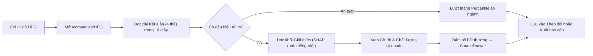
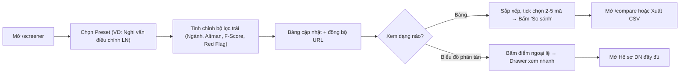
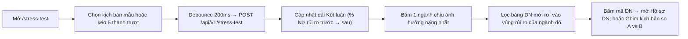

# 02 — Kiến trúc thông tin, Luồng thao tác & Wireframe chi tiết

> Nối tiếp [`PRODUCT.md`](../../PRODUCT.md), [`DESIGN.md`](../../DESIGN.md) và [`01-decisions.md`](./01-decisions.md).
> Mọi màn hình thiết kế theo nguyên tắc **Outside-in (từ JTBD → UI → BE)** và cấu trúc **Kết luận → Lý do → Bằng chứng → Nguồn**.

---

## 1. Sơ đồ định tuyến (URL Map) & Kiến trúc thông tin

| Route | Tên hiển thị (VN) | JTBD phục vụ | Ghi chú trạng thái URL |
|---|---|---|---|
| `/` | Tổng quan thị trường | J1, J6, J7 | `?scope=CONSOLIDATED&period=QUARTER` |
| `/screener` | Sàng lọc doanh nghiệp | J5 | Toàn bộ bộ lọc đồng bộ lên URL query (chia sẻ/bookmark được) |
| `/companies/[ticker]` | Hồ sơ doanh nghiệp | J1, J2, J3, J4, J8 | `?tab=overview\|statements\|ratios\|quality\|model\|lineage&scope=&period=` |
| `/compare` | So sánh doanh nghiệp | J2 | `?tickers=HPG,HSG,NKG&period=QUARTER` |
| `/stress-test` | Kịch bản sốc tài chính | J6 | `?rate=200&rev=-10&gm=-2&dso=15&dio=0` |
| `/watchlist` | Danh sách theo dõi | J5, J7 | Lưu trong `localStorage` + đối chiếu `/changes` |
| `/methodology` | Dữ liệu & Phương pháp | J3, J4 | Tab: Từ điển chỉ số · Phương pháp mô hình · Chất lượng dữ liệu |

### Khung ứng dụng chung (`AppShell`)

```text
+---------------------------------------------------------------------------------+
| [≡] FinIntel  | [ 🔍 Tìm mã hoặc tên DN...            Ctrl+K ] | [Q3/2026 ▼][HN▼] |
+---------------+-----------------------------------------------------------------+
| Tổng quan     |  Dữ liệu cập nhật đến 15/11/2026 · Nguồn: BCTC công bố          |
| Sàng lọc      |  -------------------------------------------------------------  |
| Theo dõi (4)  |                                                                 |
| So sánh       |                       NỘI DUNG CHÍNH                            |
| Kịch bản sốc  |                      (max-width: 1440px)                        |
| ------------- |                                                                 |
| Dữ liệu & PP  |                                                                 |
|               |  -------------------------------------------------------------  |
|               |  Thông tin chỉ mang tính tham khảo, không phải khuyến nghị đầu tư.|
+---------------+-----------------------------------------------------------------+
```

- **Thanh bên trái** rộng 220px (thu gọn còn 56px trên màn hình < 1280px; chuyển thành drawer ở < 768px).
- **Header** cao 52px, cố định (sticky): tìm kiếm `Ctrl+K` (hỗ trợ gõ không dấu, ví dụ "hoa phat" → `HPG`), bộ chọn kỳ (`QUARTER` / `ANNUAL`) và phạm vi (`Hợp nhất` / `Riêng lẻ`).
- **Ngăn kéo toàn cục (`SourceDrawer`)**: mở đè từ bên phải (rộng 440px) bất cứ khi nào người dùng bấm vào biểu tượng truy nguồn bên cạnh một con số. Không làm mất vị trí đang đọc.

---

## 2. Luồng thao tác cốt lõi (User Flows)

### Luồng A — Thẩm định nhanh một doanh nghiệp trong < 60 giây (J1 → J3 → J2 → J4)



### Luồng B — Sàng lọc & phát hiện ngoại lệ toàn thị trường (J5)



### Luồng C — Mô phỏng sốc lãi suất & kinh doanh (J6)



---

## 3. Wireframe chi tiết từng màn hình

### 3.1. Trang chủ — Tổng quan rủi ro thị trường (`/`)

Mục tiêu: bức tranh sức khỏe toàn bộ ~375 DN niêm yết trong 10 giây (triage-first, học Finviz + Monte Carlo).

```text
+-------------------------------------------------------------------------------+
| TỔNG QUAN RỦI RO THỊ TRƯỜNG                       Kỳ: Q3/2026 · Hợp nhất      |
+-----------------+-----------------+-----------------+-------------------------+
| DN đang theo dõi| Nguy cơ kiệt quệ| Nghi vấn Beneish| DN có >= 3 dấu hiệu đỏ  |
| 375 DN          | 42 DN (11,2%)   | 28 DN (7,5%)    | 19 DN                   |
| 18 ngành ICB    | ▲ +3 so Q2/2026 | ▼ -2 so Q2/2026 | Xem danh sách →         |
+-----------------+-----------------+-----------------+-------------------------+
| BẢN ĐỒ RỦI RO THEO NGÀNH (ICB cấp 2)        [Màu theo: Xác suất kiệt quệ ▼]  |
| +-------------------+--------------+-------------+-------------+              |
| | Bất động sản      | Xây dựng     | Thép & KL   | Thực phẩm   |  (Ô tỷ lệ    |
| | 48 DN · 18,4%     | 36 DN · 14,1%| 14 DN · 6,2%| 29 DN · 3,8%|   theo tổng  |
| +-------------------+--------------+-------------+-------------+   nợ hoặc số |
| | Bán lẻ            | Hóa chất     | Dược phẩm   | Công nghệ   |   DN; bấm ô  |
| | 18 DN · 8,0%      | 21 DN · 4,9% | 19 DN · 2,1%| 12 DN · 1,9%|   → Screener)|
| +-------------------+--------------+-------------+-------------+              |
+---------------------------------------+---------------------------------------+
| CẦN CHÚ Ý TRONG KỲ MỚI                | DANH SÁCH THEO DÕI CỦA BẠN (4 mã)     |
| DN chuyển vùng / tăng rủi ro mạnh nhất| HPG  An toàn    4,2%  0 cờ đỏ         |
| [Mã]  [Ngành]     [Thay đổi] [Rủi ro] | NVL  Nguy cơ   31,5%  4 cờ đỏ  ▲ mới  |
| ABC   Bất động sản Xám→Nguy   28,4%   | VNM  An toàn    1,8%  0 cờ đỏ         |
| XYZ   Xây dựng    +11,2 đ%    22,1%   | MWG  Vùng xám   8,9%  1 cờ đỏ         |
| ...               [Xem toàn bộ →]     | [+ Thêm mã]  [Quản lý danh sách →]    |
+---------------------------------------+---------------------------------------+
```

- **Trạng thái rỗng Watchlist:** hiện 1 khối gọn với 3 mã gợi ý bấm thêm nhanh ("Theo dõi DN để tự động nhận biến động kỳ BCTC mới — lưu ngay trên trình duyệt, không cần tài khoản").
- **Tương tác:** bấm vào thẻ KPI "Nguy cơ kiệt quệ" → nhảy sang `/screener?altman_zone=DISTRESS_ZONE`. Bấm 1 ô ngành trên heatmap → nhảy sang `/screener?icb_code_level2=...`.

---

### 3.2. Hồ sơ doanh nghiệp (`/companies/[ticker]`) — Màn hình trung tâm

Lấy cảm hứng mật độ và cấu trúc 1-trang của **Stockopedia StockReport** + thẻ cảnh báo có dải lịch sử của **GuruFocus** + giải thích **Moody's CreditEdge** + nguồn **Atlan** + Việt hóa **Simplize**.

#### Màn hình đầu tiên (Above the fold tại 1366×768)

```text
+-----------------------------------------------------------------------------------+
| HPG · Công ty Cổ phần Tập đoàn Hòa Phát             [☆ Theo dõi] [+ So sánh] [In] |
| HOSE · Thép & Kim loại (ICB cấp 3) · Chuẩn mực: TT99 (từ 2026) · Kỳ: Q3/2026 (HN) |
+-----------------------------------------------------------------------------------+
| [Tổng quan] [Báo cáo TC] [Chỉ số & So ngành] [Chất lượng LN & Cờ đỏ] [Mô hình] [Nguồn] |
+-----------------------------------------------------------------------------------+
| TẦNG 1: KẾT LUẬN TỔNG QUAN (4 VerdictCard)                                        |
| +--------------------+--------------------+--------------------+----------------+ |
| | Xác suất kiệt quệⓘ | Altman Z″ ⓘ        | Piotroski F ⓘ      | Beneish M8 ⓘ   | |
| | 4,2%               | 3,42               | 7 / 9              | −2,61          | |
| | [✓ An toàn]        | [✓ An toàn]        | ●●●●●●●○○          | [✓ Bình thường]| |
| | +0,6 đ% so Q2/2026 | Ngưỡng > 2,60      | Đủ 9/9 tiêu chí    | Ngưỡng ≤ −1,78 | |
| | Phân nhóm: Sản xuất| 10 kỳ: 2,8–3,9     | (Q2: 6/9)          | 10 kỳ: −3,1..−2| |
| +--------------------+--------------------+--------------------+----------------+ |
|                                                                                   |
| TẦNG 2: VÌ SAO CÓ ĐÁNH GIÁ NÀY? (Hai cột 60% / 40%)                               |
| +-------------------------------------------+-----------------------------------+ |
| | CÁC YẾU TỐ TÁC ĐỘNG ĐẾN XÁC SUẤT KIỆT QUỆ | DẤU HIỆU BẤT THƯỜNG (0 nghiêm trọng| |
| | [Biểu đồ Waterfall SHAP: nền → top 5 tăng |  · 1 cần lưu ý)                   | |
| |  rủi ro (đỏ thẫm) · top 5 giảm rủi ro     |                                   | |
| |  (xanh dịu) · Các yếu tố khác → 4,2%]     | [▲ Trung bình] RF_04 Hàng tồn kho | |
| |                                           | Vòng quay tồn kho chậm hơn 22 ngày| |
| | Diễn giải (quy tắc cố định):              | so trung vị ngành Thép.           | |
| | • Đòn bẩy nợ vay/VCSH (0,62x) thấp hơn    | [Xem bằng chứng & nguồn →]        | |
| |   trung vị ngành (0,95x), giúp giảm rủi ro|                                   | |
| | • Dòng tiền kinh doanh/LNST đạt 1,18x     | Kiểm toán & Hồ sơ gần nhất:       | |
| | • Số ngày tồn kho (98 ngày) cao hơn ngành | • Q2/2026 (Soát xét): Chấp nhận TP| |
| | [Phương pháp mô hình v2.1] [Xem dạng bảng]| • Điều chỉnh hồi tố 3 năm: Không  | |
| +-------------------------------------------+-----------------------------------+ |
+-----------------------------------------------------------------------------------+
```

#### Tầng 3 trong Tab Tổng quan (cuộn xuống) — Chỉ số cốt lõi kiểu Stockopedia Traffic Light

```text
+-----------------------------------------------------------------------------------+
| VỊ THẾ SO VỚI NGÀNH THÉP (ICB cấp 3 · 14 DN)       [Tuyệt đối | Phân vị] [Ngành ▼]|
+-----------------------------+----------+----------+--------------------------+----+
| Chỉ số                      | HPG      | TV ngành | Thứ hạng trong ngành     | 8Q |
+-----------------------------+----------+----------+--------------------------+----+
| SINH LỜI                                                                          |
| Biên lợi nhuận gộp ⓘ  [🔗] | 15,2%    | 11,4%    | [███████████████░░░] 78% | ▁▂▄▆|
| ROE (tổng VCSH) ⓘ     [🔗] | 12,8%    |  8,1%    | [████████████████░░] 84% | ▁▃▅▆|
| Biên LN hoạt động cốt lõiⓘ | 11,9%    |  7,2%    | [█████████████████░] 88% | ▂▃▅▆|
| THANH KHOẢN & ĐÒN BẨY                                                             |
| Hệ số thanh toán ngắn hạnⓘ | 1,42x    |  1,28x   | [████████████░░░░░░] 64% | ▄▅▅▄|
| Nợ vay / VCSH ⓘ       [🔗] | 0,62x    |  0,95x   | [██████████████░░░░] 72% | ▆▅▄▃|
| Khả năng trả lãi vay ⓘ[🔗] | 5,40x    |  3,10x   | [███████████████░░░] 79% | ▂▃▄▆|
| CHẤT LƯỢNG LỢI NHUẬN                                                              |
| Dòng tiền KD / LNST ⓘ [🔗] | 1,18x    |  0,85x   | [████████████████░░] 81% | ▃▅▄▆|
| Dồn tích / Tổng tài sảnⓘ   | −2,1%    | +1,4%    | [█████████████████░] 86% | ▅▄▃▂|
+-----------------------------+----------+----------+--------------------------+----+
* Ghi chú: Với chỉ số "càng thấp càng tốt" (Nợ/VCSH, Dồn tích/TS), thanh dài màu xanh
  nghĩa là thuộc nhóm an toàn nhất ngành. Bấm [🔗] mở SourceDrawer. Bấm dòng → PeerBand.
```

#### Các tab còn lại trên Hồ sơ DN
- **Tab `Báo cáo tài chính` (`?tab=statements`):**
  - Chuyển nhanh: `CĐKT` · `KQKD` · `LCTT`.
  - Chuyển chế độ: `Giá trị (tỷ đồng)` · `Tỷ trọng (% doanh thu / tổng TS)` · `Tăng trưởng YoY (%)`.
  - Cột `Chỉ tiêu` ghim trái, cột kỳ sắp mới → cũ (mặc định 8 quý hoặc 5 năm), dòng cha có thể thu gọn/mở rộng, dấu `( )` cho số âm, gạch dưới kép cho dòng tổng.
  - Đánh dấu trực quan ranh giới cột khi có chuyển chuẩn mực `TT200 → TT99` (và đánh dấu dòng có `comparable_across_taxonomy: false`).
- **Tab `Chỉ số & So ngành` (`?tab=ratios`):**
  - Chọn bất kỳ chỉ số nào trong 38 chỉ số → biểu đồ **PeerBandChart** (dải P25–P75 + đường trung vị ngành nét đứt + đường DN; đoạn rơi về `REGIME_FALLBACK` tô nền sọc kèm cảnh báo).
  - Biểu đồ Box Plot phân bố toàn ngành tại kỳ chọn + Bảng xếp hạng các DN cùng ngành (bấm mã khác để mở so sánh).
  - Khối **Phân tích DuPont 5 nhân tố** (Gánh nặng thuế × Gánh nặng lãi vay × Biên EBIT × Vòng quay TS × Đòn bẩy = ROE) dạng bảng + biểu đồ xu hướng.
- **Tab `Chất lượng lợi nhuận & Cờ đỏ` (`?tab=quality`):**
  - Khối **Core Earnings** (Rouen, So & Wang 2021): Lợi nhuận hoạt động cốt lõi vs Lợi nhuận trước thuế, tỷ lệ bóp méo ngoài cốt lõi (`non_core_distortion_to_assets`), giải thích `RF_08` & `RF_09`.
  - Danh sách đầy đủ 9 quy tắc kiểm tra (`RF_01`–`RF_09`) — hiển thị **cả quy tắc ĐẠT và quy tắc KÍCH HOẠT** theo dạng checklist forensic (học Simply Wall St/GuruFocus: người dùng cần biết hệ thống đã kiểm tra 9 thứ và 8 thứ sạch, không chỉ thấy 1 dòng lỗi rồi tự hỏi 8 thứ kia có chạy không!).
  - Lịch sử kiểm toán & điều chỉnh hồi tố từ `filings_manifest` (ý kiến kiểm toán, ngày công bố, `revision_no`, `revision_reason`).
- **Tab `Mô hình rủi ro & Giải thích` (`?tab=model`):**
  - Lịch sử điểm số (Altman Z″, Piotroski F, Beneish M8, Xác suất kiệt quệ) qua tất cả các kỳ có sẵn trong `ml_scores`.
  - Bảng phân rã chi tiết SHAP (tên chỉ tiêu, giá trị DN, trung vị ngành, mức tác động, hướng).
  - Khối thông tin quản trị mô hình: phân nhóm đặc trưng (`cluster_archetype_name`), điểm ngoại lệ thống kê (`anomaly_percentile_rank`), `model_version`, `model_role`, giới hạn áp dụng (ví dụ cảnh báo với `BANK`).
- **Tab `Nguồn dữ liệu` (`?tab=lineage`):**
  - Danh sách 38 chỉ số với trạng thái tính toán; bấm mỗi chỉ số mở `SourceDrawer` hiển thị công thức, từng thành phần tử số/mẫu số (`metric_id`, mã TT200/TT99, giá trị, `filing_id`, `published_at`, `effective_available_at`, `canonical_content_sha256`).

---

### 3.3. Ngăn kéo truy nguồn (`SourceDrawer` — dùng mọi nơi)

```text
+--------------------------------------------+
| NGUỒN DỮ LIỆU CHỈ SỐ                   [✕] |
| ROE (Lợi nhuận / Vốn chủ bình quân)        |
| HPG · Q3/2026 · Hợp nhất · Chuẩn TT99      |
+--------------------------------------------+
| Kết quả: 12,8%        [Trạng thái: Hợp lệ] |
| Công thức: LNST TTM / ((VCSH đầu + cuối)/2)|
+--------------------------------------------+
| TỬ SỐ (NUMERATOR)                          |
| • IS_NET_INCOME (Mã TT99: 60)              |
|   Giá trị: 12.450,2 tỷ đồng                |
|   Kỳ: Q3/2026 · Phương pháp: TTM_4Q        |
|   Công bố: 29/10/2026 · Hồ sơ: FL-2026-Q3  |
+--------------------------------------------+
| MẪU SỐ (DENOMINATOR)                       |
| • BS_TOTAL_EQUITY (Mã TT99: 400) — đầu kỳ  |
|   Giá trị: 95.120,0 tỷ đồng · Q3/2025      |
| • BS_TOTAL_EQUITY (Mã TT99: 400) — cuối kỳ |
|   Giá trị: 99.410,5 tỷ đồng · Q3/2026      |
+--------------------------------------------+
| DẤU VÂN TAY DỮ LIỆU (KIỂM CHỨNG)           |
| Nguồn: FHSC_OAPI · SHA-256: 8a9f...c41b    |
| [Xem định nghĩa trong Từ điển chỉ số →]    |
+--------------------------------------------+
```

---

### 3.4. Sàng lọc doanh nghiệp (`/screener`)

```text
+-----------------------------------------------------------------------------------+
| SÀNG LỌC DOANH NGHIỆP                                 Hiển thị 1–50 / 375 DN      |
| Bộ lọc mẫu: [Tất cả] [Nghi vấn điều chỉnh LN] [Sức khỏe cao + LN thật] [Vùng xám] |
|             [Nhạy cảm lãi suất] [Đang theo dõi]                                   |
+-------------------------+---------------------------------------------------------+
| BỘ LỌC           [Xóa]  | [Bảng | Phân tán rủi ro] [Mật độ: Gọn|Thoải] [Xuất CSV] |
|                         | Đã chọn 2 mã: [So sánh (2)]                             |
| Ngành ICB cấp 2         +---------------------------------------------------------+
| [Tất cả ngành       ▼]  | ☐ | Mã  | Ngành    | Altman   | F  | Beneish| P(KQ) |Cờ |
|                         |---+-----+----------+----------+----+--------+-------+---|
| Vùng Altman             | ☑ | HPG | Thép     | ✓ 3,42   | 7  | −2,61  |  4,2% | 1 |
| [Tất cả] [An toàn]      | ☑ | HSG | Thép     | ▲ 2,15   | 5  | −1,92  |  9,8% | 2 |
| [Vùng xám] [Nguy cơ]    | ☐ | ABC | BĐS      | ■ 0,94   | 2  | −1,12! | 34,1% | 5 |
|                         | ...                                                     |
| Dấu hiệu Beneish        | (Cột Mã ghim trái; số căn phải; thanh mini-bar cho P(KQ)|
| [Tất cả] [Nghi vấn]     |  bấm hàng → mở Hồ sơ; bấm nút 'Xem nhanh' → Drawer)     |
|                         +---------------------------------------------------------+
| Piotroski F tối thiểu   | ‹ Trước   Trang 1 / 8   Sau ›         [50 dòng/trang ▼] |
| [0]=====●=======[9]  5  +---------------------------------------------------------+
|                         | (Khi bật chế độ 'Phân tán rủi ro': trục X = Altman Z″,  |
| Xác suất kiệt quệ ≤     |  trục Y = Xác suất kiệt quệ, màu = Vùng Altman,         |
| [0%]======●===[100%] 20%|  vẽ đường ngưỡng 1,10 và 2,60; bấm điểm mở xem nhanh)   |
|                         |                                                         |
| Số cờ đỏ tối đa         |                                                         |
| [0]====●=======[9]   2  |                                                         |
+-------------------------+---------------------------------------------------------+
```

- **Bộ lọc mẫu (Preset Screeners — cấu hình tĩnh ở FE, map thẳng vào query params của `/api/v1/screener`):**
  1. *Nghi vấn điều chỉnh lợi nhuận:* `beneish_flag=MANIPULATOR_LIKELY` (hoặc giá trị enum thực tế của backend).
  2. *Sức khỏe tài chính cao:* `altman_zone=SAFE_ZONE&min_f_score=7&max_red_flags=0`.
  3. *Vùng xám cần theo dõi:* `altman_zone=GREY_ZONE`.
  4. *Nguy cơ kiệt quệ cao:* `altman_zone=DISTRESS_ZONE`.
- **An toàn CSV:** giữ trung hòa CSV Injection (`'=` / `'+` / `'-` / `'@`) trong helper xuất CSV ở FE (và nếu BE xuất thì BE cũng trung hòa).

---

### 3.5. Kịch bản sốc tài chính (`/stress-test`)

Áp dụng mô hình **3 vùng** (trái = điều khiển, trên = kết luận, giữa = tác động ngành + DN) khớp đúng 5 tham số thật của `StressScenarioRequest` trong `api.py` (không chỉ lãi suất — backend hỗ trợ cả doanh thu, biên gộp, DSO, DIO!).

```text
+-----------------------------------------------------------------------------------+
| MÔ PHỎNG KỊCH BẢN SỐC TÀI CHÍNH (Phương pháp IMF WP/15/216 · Chow 2015)           |
| Kịch bản mẫu: [Tăng lãi suất +200 bps] [Suy thoái nhẹ] [Khủng hoảng kép] [Đặt lại]|
+-----------------------------+-----------------------------------------------------+
| THAM SỐ KỊCH BẢN            | KẾT LUẬN TOÀN THỊ TRƯỜNG (375 DN · Tổng nợ X tỷ)    |
|                             | +---------------+---------------+-----------------+ |
| Sốc lãi suất (bps)          | | Nợ rủi ro gốc | Sau kịch bản  | DN mới gặp khó  | |
| [-500]===●=====[+1500] [+200]| | 14,2%         | 22,8% (+8,6đ%)| +27 DN          | |
|                             | +---------------+---------------+-----------------+ |
| Sốc doanh thu (%)           | [Ghim làm kịch bản A]  [So sánh A vs B] [Xuất CSV]  |
| [-80%]====●====[+50%]  [-10]|                                                     |
|                             | TÁC ĐỘNG THEO NGÀNH ICB CẤP 2                       |
| Sốc biên lãi gộp (đ%)       | [Biểu đồ cột ghép ngang: % Nợ rủi ro Trước (xám) vs |
| [-50]=====●====[+20]    [-2]|  Sau sốc (đỏ thẫm), sắp xếp theo mức tăng giảm dần; |
|                             |  bấm 1 ngành để lọc bảng DN bên dưới]               |
| Kéo dài phải thu - DSO (ngày)|                                                    |
| [-90]=====●====[+180]  [+15]| DANH SÁCH DN CHỊU TÁC ĐỘNG                          |
|                             | [Mới rơi vào rủi ro (27)] [Nợ rủi ro lớn nhất (50)] |
| Kéo dài tồn kho - DIO (ngày)| Mã | Ngành | Tổng nợ | ICR gốc → Sau | CFO gốc→Sau  |
| [-90]=====●====[+180]    [0]| ...                                                 |
|                             |                                                     |
| * Cảnh báo hợp lý nếu kéo   | (Khi đang gửi request: phủ mờ nhẹ bảng kết quả kèm  |
|   vượt biên lịch sử         |  nhãn "Đang tính lại..." — không xóa dữ liệu cũ)    |
+-----------------------------+-----------------------------------------------------+
```

- **Dual-input:** mọi thanh trượt đều có ô nhập số chính xác bên cạnh + kiểm tra biên khớp Pydantic (`interest_rate_shock_bps: [-500, 1500]`, `revenue_shock_pct: [-80%, +50%]`, `gross_margin_shock_pp: [-50, +20]`, `dso_shock_days: [-90, +180]`, `dio_shock_days: [-90, +180]`).
- **Xử lý 503 từ semaphore:** hiển thị trạng thái chờ nhẹ và tự thử lại 1 lần sau `Retry-After` (1 giây) thay vì báo lỗi thô.

---

### 3.6. So sánh 2–5 doanh nghiệp (`/compare`)

```text
+-----------------------------------------------------------------------------------+
| SO SÁNH DOANH NGHIỆP              [+ Thêm mã (tối đa 5)]   Kỳ: Q3/2026 · Hợp nhất |
| Đang so sánh: [HPG ×] [HSG ×] [NKG ×] [TVN ×]        [Giá trị tuyệt đối | Phân vị]|
+-----------------------------------------------------------------------------------+
| BIỂU ĐỒ XU HƯỚNG CHỈ SỐ: [Chọn chỉ số: ROE ▼] (tối đa 5 đường màu từ chart-series)|
+-----------------------------------------------------------------------------------+
| Chỉ tiêu (ghim trái)      | HPG (đầu bảng) | HSG       | NKG       | TV ngành     |
|---------------------------+----------------+-----------+-----------+--------------|
| Xác suất kiệt quệ         |  4,2% ✓        |  9,8% ▲   | 11,4% ▲   |  6,2%        |
| Altman Z″                 |  3,42 ✓        |  2,15 ▲   |  1,98 ▲   |  2,40        |
| Piotroski F               |   7/9          |   5/9     |   4/9     |   6/9        |
| Beneish M8                | −2,61 ✓        | −1,92 ✓   | −1,65 ■   | −2,18        |
| Biên lãi gộp              | 15,2%          | 11,0%     |  8,4%     | 11,4%        |
| Nợ vay / VCSH             | 0,62x          | 0,88x     | 1,15x     | 0,95x        |
| Số cờ đỏ                  |     1          |     2     |     3     |     —        |
+-----------------------------------------------------------------------------------+
```

---

### 3.7. Dữ liệu & Phương pháp (`/methodology`)

Tách bạch rõ ràng:
1. **Tab `Từ điển chỉ số` (38 chỉ số):** tìm kiếm, lọc theo nhóm (Sinh lời, Thanh khoản, Đòn bẩy, Hiệu quả, Chất lượng LN), mỗi dòng có tên tiếng Việt, công thức, ý nghĩa chiều tốt/xấu, mã TT200 ↔ TT99.
2. **Tab `Phương pháp mô hình`:** Altman Z″ / EM, Piotroski F, Beneish M8, Core Earnings (Rouen et al. 2021), 9 quy tắc cờ đỏ, mô hình kiệt quệ + TreeSHAP, mô hình stress test (Chow 2015), giới hạn áp dụng.
3. **Tab `Chất lượng dữ liệu`:** tổng quan snapshot (`total_issuers`, `pass_periods`, `warning_periods`, `quarantined_rows`), bảng `quality/summary` và `quality/quarantine` phân trang phía server (triage-first, lọc theo trạng thái).

---

## 4. Ma trận 4 trạng thái & Responsive

| Màn hình | `loading` | `empty` | `error` | Mobile (`375px`) |
|---|---|---|---|---|
| Trang chủ | Skeleton 4 KPI + khung heatmap | "Chưa có snapshot dữ liệu" + hướng dẫn kiểm tra API | Thông báo đã làm sạch + nút Thử lại | KPI 2×2; heatmap chuyển thành danh sách ngành có thanh ngang |
| Hồ sơ DN | Skeleton dải 4 thẻ + vùng chart | "Không tìm thấy mã X" + gợi ý tìm mã khác | 404 → gợi ý tìm; 500 → thông báo sạch + Thử lại | 4 thẻ xếp 2×2; bảng BCTC cuộn ngang có cột tên chỉ tiêu ghim; tab cuộn ngang |
| Sàng lọc | Skeleton 10 dòng bảng | "Không có DN thỏa bộ lọc" + nút "Đặt lại bộ lọc" | Banner lỗi trên bảng, giữ nguyên bộ lọc đang chọn | Bộ lọc chuyển thành nút "Bộ lọc (N)" mở drawer dưới/phải |
| Stress test | Phủ mờ nhẹ kết quả cũ + badge "Đang tính lại" | "Không có dữ liệu đầu vào cho kỳ đã chọn" | 503 → tự retry; 422 → chỉ rõ ô tham số sai | Bộ điều khiển xếp trên dạng accordion thu gọn được |
