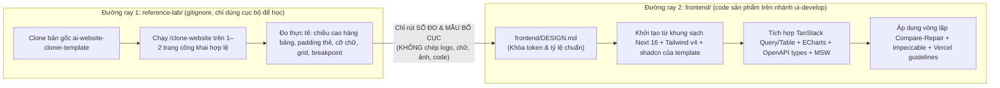

# 04 — Playbook sử dụng `ai-website-cloner-template` đúng cách (Tránh "thiết kế tự phát" & giữ an toàn bản quyền)

> Đã kiểm tra mã nguồn thật của `JCodesMore/ai-website-cloner-template` (v0.6.1, giấy phép MIT) gồm `package.json`, `AGENTS.md`, `.agents/skills/clone-website/SKILL.md` và `references/inspection-guide.md`.

---

## 1. Vì sao nên dùng `ai-website-cloner-template`?

Trực giác của bạn rất chính xác: nếu một người không chuyên UI/UX (hoặc AI agent) **tự vẽ bố cục từ giấy trắng**, kết quả rất dễ mắc lỗi "thiết kế tự phát / giao diện AI": khoảng cách lộn xộn, cỡ chữ lệch nhịp, bảng dữ liệu quá thưa hoặc quá chật, thanh điều hướng thừa thãi, responsive bị vỡ.

Sau khi đọc kỹ mã nguồn `ai-website-cloner-template`, giá trị thật sự của nó nằm ở **3 điểm kỹ thuật** (chứ không phải ở việc copy nguyên trang người khác):

1. **Khung kỹ thuật sạch & mới nhất:** Next.js 16 (App Router) · React 19 · TypeScript strict (no `any`) · Tailwind CSS v4 (oklch tokens) · shadcn/ui (`@base-ui/react`) · Lucide React · ESLint 9 · lệnh `npm run check` (`lint && typecheck && build`).
2. **Kỷ luật đo đạc trước khi code (`inspection-guide.md`):** thay vì "nhìn bằng mắt rồi đoán", nó ép agent đo `getBoundingClientRect()`, computed `font-family`, `font-size`, `line-height`, `gap`, `padding`, `border-radius`, và quét nhiều chiều rộng màn hình (mobile → 1366px → 1440px → >1440px).
3. **Vòng lặp kiểm chứng trực quan (`SKILL.md §4 — Compare, repair, repeat`):** dựng xong không tự khen "xong rồi", mà phải mở trình duyệt thật ở đúng kích thước màn hình, chụp ảnh, kiểm tra lỗi runtime / tràn ngang / mất tài sản, sửa lỗi lớn nhất trước rồi kiểm tra lại.

---

## 2. Kiến trúc 2 đường ray (Two-Track) — Tận dụng 100% sức mạnh, 0% rủi ro bản quyền

Nếu dùng thẳng `/clone-website` để sửa thành sản phẩm nộp đồ án sẽ có 2 rủi ro: (a) vi phạm điều khoản/bản quyền nếu còn sót logo, chữ, tài sản của trang gốc; (b) `SKILL.md` gốc ưu tiên trang marketing/landing ("match source 1:1"), còn FinIntel là ứng dụng dữ liệu động gọi FastAPI.

Giải pháp chuẩn là tách làm **2 thư mục độc lập**:



### Quy tắc ranh giới cứng giữa 2 đường ray

| Hạng mục | `reference-lab/` (cục bộ, gitignored) | `frontend/` (sản phẩm, commit lên `ui-develop`) |
|---|---|---|
| Mục đích | Phòng thí nghiệm giải phẫu bố cục & nhịp khoảng cách | Ứng dụng web FinIntel chính thức |
| Nguồn trang tham khảo | **Chỉ trang công khai** (không vượt paywall, không vượt CAPTCHA, tôn trọng ToS) | Không chứa bất kỳ URL/asset nào của trang ngoài |
| Tài sản (logo, SVG, font có bản quyền, nội dung chữ) | Chỉ lưu tạm để học cơ chế | **Tuyệt đối cấm chép sang**; chỉ dùng Google Fonts (IBM Plex Sans/Mono), Lucide icons, dữ liệu từ FastAPI FinIntel |
| Quy tắc `AGENTS.md` | Giữ nguyên rule "emulation 1:1" của template | Dùng rule sản phẩm FinIntel: `PRODUCT.md` + `DESIGN.md` + vòng lặp kiểm chứng trực quan |

---

## 3. Áp dụng cụ thể cho từng phần của `frontend/`

### 3.1. Điều chỉnh từ `ai-website-cloner-template` sang `frontend/`

Khi copy khung kỹ thuật từ template vào `d:\KiCuoiCung\DATN\financial-intelligence\frontend\`:

- **Giữ nguyên:**
  - `next.config.ts` (bổ sung `rewrites` proxy `/api/v1/:path*` → `http://127.0.0.1:8000/api/v1/:path*` cho môi trường dev)
  - `tsconfig.json` (TypeScript strict), `eslint.config.mjs`, `postcss.config.mjs`, `components.json`
  - `src/lib/utils.ts` (`cn()`), `src/components/ui/` (primitives shadcn/Base UI)
  - Bộ script `npm run dev`, `npm run lint`, `npm run typecheck`, `npm run build`, `npm run check`
- **Bỏ khỏi `frontend/`:**
  - `docs/assets/sponsors/`, `docs/design-references/comparison.png`, banner README của template
  - `src/components/sites/`, `public/sites/` (chỉ dùng cho clone nhiều site)
  - Câu *"Pixel-perfect emulation / use actual text and assets from target site"* trong `AGENTS.md`
- **Thay bằng / Bổ sung:**
  - `frontend/PRODUCT.md` & `frontend/DESIGN.md` (đã viết sẵn!)
  - `frontend/AGENTS.md` riêng cho FinIntel: bắt buộc đọc `PRODUCT.md` + `DESIGN.md`, áp dụng vòng lặp 4 bước **Map → Spec → Build → Visual Verify** (mượn tinh hoa từ `clone-website/SKILL.md` §4), và chạy `npm run check` + Playwright visual check sau mỗi màn hình.
  - Gói phụ trợ cho ứng dụng tài chính:
    - Runtime: `@tanstack/react-query`, `@tanstack/react-table`, `echarts`, `nuqs`, `zod`
    - Dev/Test: `openapi-typescript`, `msw`, `vitest`, `@testing-library/react`, `@playwright/test`, `@axe-core/playwright`

### 3.2. Các công cụ AI Agent bổ trợ đi kèm (bộ tối thiểu, không xung đột)

| Vai trò | Công cụ | Cách tích hợp |
|---|---|---|
| Kiểm chứng trên trình duyệt thật | **Chrome DevTools plugin** (Marketplace) + **Playwright** | Chụp ảnh desktop (`1366×768`, `1440×900`) + mobile (`375×812`), kiểm tra console errors, network 4xx/5xx, tràn ngang |
| Chống "giao diện AI" & đánh bóng | **Impeccable** (`pbakaus/impeccable`) | Dùng `critique`, `audit`, `distill`, `harden`, `polish` sau khi dựng xong từng màn hình (đọc cùng `PRODUCT.md` + `DESIGN.md`) |
| Kiểm tra a11y & chuẩn web | **Vercel `web-design-guidelines`** (`vercel-labs/agent-skills`) | Rà bàn phím, focus ring, nhãn ARIA, cấu trúc form/bảng |
| Rút token đo tham khảo | **Dembrandt** (`npx dembrandt <public-url> --design-md`) | Chạy trên trang công khai (VD Simplize/Koyfin trang công khai) để đối chiếu thang cỡ chữ/spacing vào `DESIGN.md`, **không** chép màu thương hiệu |
| Thiết kế wireframe/mockup (nếu dùng) | **Figma plugin** (Marketplace) | Dùng khi muốn duyệt layout trên Figma trước khi code |

### 3.3. Cấu trúc thư mục `frontend/` đề xuất

```text
frontend/
├── AGENTS.md                   # Luật cho AI agent làm FE (mượn kỷ luật kiểm chứng của cloner)
├── PRODUCT.md                  # Nguồn sự thật sản phẩm (đã tạo)
├── DESIGN.md                   # Nguồn sự thật giao diện & token (đã tạo)
├── docs/design/                # Bộ tài liệu thiết kế 01..05 (đã tạo)
├── next.config.ts              # Proxy /api/v1/* → FastAPI local
├── package.json
├── src/
│   ├── app/
│   │   ├── layout.tsx          # IBM Plex Sans + Mono (next/font), AppShell, QueryProvider
│   │   ├── globals.css         # Token từ DESIGN.md ánh xạ sang Tailwind v4 @theme
│   │   ├── page.tsx            # / — Tổng quan thị trường
│   │   ├── screener/page.tsx   # /screener — Sàng lọc doanh nghiệp
│   │   ├── companies/[ticker]/page.tsx  # /companies/[ticker] — Hồ sơ DN
│   │   ├── compare/page.tsx    # /compare — So sánh 2–5 DN
│   │   ├── stress-test/page.tsx# /stress-test — Kịch bản sốc
│   │   ├── watchlist/page.tsx  # /watchlist — Danh sách theo dõi (localStorage)
│   │   └── methodology/page.tsx# /methodology — Từ điển, Phương pháp, Chất lượng
│   ├── components/
│   │   ├── ui/                 # shadcn/Base UI primitives
│   │   ├── layout/             # AppShell, Sidebar, TopBar, CommandSearch, PeriodPicker, SourceDrawer
│   │   ├── financial/          # VerdictCard, RiskBadge, ScoreDots, PercentileBar, MetricRow, FinancialTable
│   │   └── charts/             # ExplainWaterfall, PeerBandChart, SectorHeatmap, ScreenerScatter, StressSectorBar
│   ├── lib/
│   │   ├── format.ts           # Định dạng số vi-VN, tỷ đồng, ngoặc âm, dấu −, N/A, CSV-injection guard
│   │   ├── narrative.ts        # Diễn giải SHAP tiếng Việt theo quy tắc cố định (không LLM)
│   │   ├── api-client.ts       # Fetch typed + ETag/304 + sanitize lỗi
│   │   └── watchlist-store.ts  # localStorage + export/import JSON
│   ├── hooks/                  # TanStack Query hooks gắn khóa [snapshotId, ...]
│   ├── mocks/                  # MSW handlers cho các endpoint BE mới (G1–G10)
│   └── types/
│       └── api.generated.ts    # Sinh tự động từ FastAPI /openapi.json
└── tests/
    ├── unit/                   # Vitest: format.ts, narrative.ts, CSV injection guard
    └── e2e/                    # Playwright: luồng chính + axe-core + chụp ảnh đối chiếu
```

---

## 4. Ghi chú môi trường máy hiện tại (đã kiểm tra thực tế)

- `ai-website-cloner-template` yêu cầu `node >= 24`.
- Trên máy hiện tại, `node` chưa có sẵn trong `PATH` mặc định của shell mới, nhưng **Node.js `v26.13.0` đã được cài sẵn qua `fnm`** tại:
  `%APPDATA%\fnm\node-versions\v26.13.0\installation` (có đủ `node.exe`, `npm.cmd`, `npx.cmd`).
- Khi chạy lệnh build/dev trong PowerShell, chỉ cần thêm thư mục trên vào `$env:PATH` (hoặc kích hoạt `fnm env --use-on-cd | Out-String | Invoke-Expression`).
- Thư mục `reference-lab/` cần thêm vào `.gitignore` gốc (`/reference-lab/`) để chắc chắn không bao giờ commit dữ liệu/tài sản của trang tham khảo lên Git.
