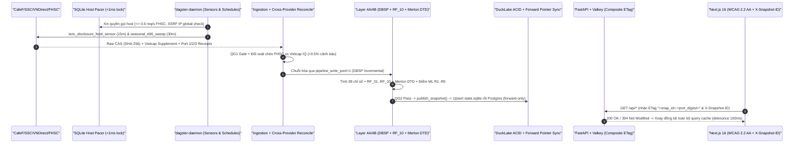

# FinIntel V2.0 — Đặc Tả Kỹ Thuật Trung Tâm (`spec/SPEC-v2-autonomous-institutional-finintel.md`)

> **Phiên bản:** `v2.0` (Hợp nhất *Tự động hóa thu thập liên tục Write-Audit-Publish* & *Tinh gọn kiến trúc Lakehouse + Chiều sâu định lượng định chế*)  
> **Chuẩn phương pháp áp dụng:** Spec-Driven Development (`capability-map.md` + `SPEC.md`) · Constraint-Driven Development (`CONSTRAINTS.md`) · Source-Driven Development · Code Simplification · Doubt-Driven Adversarial Review · Observability & Runbooks · Performance Optimization · WCAG 2.2 AA Accessibility Engineering

---

## 1. Khóa Phiên Bản Công Nghệ, Giả Định Tường Minh & Nguồn Tài Liệu Gốc (`Source-Driven`)

### 1.1. Bảng Khóa Phiên Bản Thực Tế Trong Kho Mã Nguồn
Mọi cú pháp API trong đặc tả này được ghim cứng theo `pyproject.toml` và `frontend/package.json`:

- **Backend (`Python >=3.11`):** `polars==1.35.2`, `duckdb==1.4.2`, `filelock==4.2.10`, `tenacity==9.2.1`, `httpx==0.28.1`, `vnstock-oapi==0.1.2`, `xgboost==2.1.4`, `scikit-learn==1.7.2`, `scipy==1.17.1`, `shap==0.49.1`, `dagster==1.13.30`, `dagster-webserver==1.13.30`, `dagster-postgres==0.29.30`, `fastapi==0.165.0`, `pydantic==2.14.4`, `psycopg[binary]==3.3.9`, `redis==8.1.0`, `structlog==26.1.0`, `prometheus-client==0.26.0`, `opentelemetry-api==1.45.2`, `opentelemetry-sdk==1.45.2`, `pymupdf==2.1`, `pgvector==0.5.1`.
- **Frontend (`Node >=24`):** `next==16.3.5`, `react==19.2.4`, `@base-ui/react==^1.3.0`, `@tanstack/react-query==^5.90.0`, `echarts==^6.0.0`, `zod==^4.0.0`, `vitest==^4.0.0`, `@playwright/test==^1.65.1`, `@axe-core/playwright==^4.14.0`.

### 1.2. Nguồn Tài Liệu Chính Thống & Học Thuật Đã Đối Chiếu
1. **Quyết định giữ DuckDB/Polars/DuckLake đơn nút & bác bỏ Spark/Hadoop/Kafka:**
   - McSherry, F., Isard, M., & Murray, D. G. (2015). *"Scalability! But at what COST?"* 15th USENIX HotOS (`COST` metric: với dữ liệu bảng BCTC Việt Nam `< 10 GB`, Polars/DuckDB trên 1 nút vượt cụm JVM phân tán đồng thời triệt tiêu chi phí vận hành ZooKeeper/JVM).
   - Budiu, M. et al. (2023). *"DBSP: Automatic Incremental View Maintenance for Rich Query Languages."* PVLDB Vol. 16, No. 7 (Cơ sở cho `src/finintel/transform/incremental.py`).
   - Boyko, O. (2026). *"Big Data Analytics in Finance: Building an Audit-First Stack."* (`BCBS 239`: ưu tiên tính truy vết kiểm toán dòng chảy chỉ tiêu, bất biến hóa snapshot và kiểm soát chất lượng trước khi xuất bản).
   - TS. Triệu Thu Hương & ThS. Nguyễn Dương Hùng (2024). *"Đánh giá các công nghệ Big Data cho lĩnh vực tài chính - ngân hàng."* Tạp chí Ngân hàng.
2. **Tài liệu kỹ thuật chính thức cho Hạ tầng & Giao diện:**
   - Dagster `1.13` Sensors, Schedules, Concurrency Pools & Read-Only Webserver.
   - DuckLake `0.3` ACID Snapshots & Maintenance (`expire_snapshots`, `cleanup_old_files`).
   - Polars `1.35` `DataFrame.join_asof` (`strategy="forward"` vs `strategy="backward"`).
   - SQLite Write-Ahead Logging & `BEGIN IMMEDIATE` Concurrency.
   - OpenTelemetry Python `1.45` Traces & Prometheus Histograms.
   - W3C WCAG 2.2 AA (`SC 1.4.10 Reflow`, `SC 2.4.11 Focus Not Obscured`, `SC 2.5.8 Target Size Minimum`, WAI-ARIA Tabs Pattern).
3. **Chuẩn mực Pháp lý Kế toán Việt Nam & Học thuật Tài chính Định chế:**
   - **Thông tư 200/2014/TT-BTC**, **Thông tư 99/2025/TT-BTC** (hiệu lực 01/01/2026) và **Thông tư 96/2020/TT-BTC** (thời hạn công bố thông tin BCTC trên HOSE, HNX, UPCOM).
   - **Tín hiệu Điều tra Hậu kiểm toán (`RF_10`):** Dechow, P. M., Ge, W., Larson, C. R., & Sloan, R. G. (2011), *"Predicting Material Accounting Misstatements"*, Contemporary Accounting Research, 28(1), 17–82; Schilit, H. M. et al. (2018), *Financial Shenanigans* (4th Ed.).
   - **Mô hình Cấu trúc Thị trường Merton Distance-to-Default (`DTD`):** Bharath, S. T., & Shumway, T. (2008), *"Forecasting Default with the Merton Distance to Default Model"*, Review of Financial Studies, 21(3), 1339–1369; Duan, J.-C., Sun, J., & Wang, T. (2012), *"Multiperiod Corporate Default Prediction — A Forward Intensity Approach"*, Journal of Econometrics, 170(1), 191–209 (NUS-CRI).

### 1.3. Giả Định Tường Minh Đã Xác Minh Từ Codebase
1. Kho mã nguồn đã có sẵn `src/finintel/ingestion/vietcap_supplement.py` và hàm `coalesce_cross_provider_facts` trong `src/finintel/normalization/periods.py`. V2.0 kế thừa trực tiếp hai cấu phần này để xây cơ chế đối soát chéo đa nguồn (`FHSC` ↔ `Vietcap IQ`).
2. Tất cả các module thuộc nhóm `platform` (`dagster`, `fastapi`, `pydantic`, `psycopg`, `redis`, `structlog`, `opentelemetry`) và nhóm `rag`/`ocr` (`pymupdf`, `pgvector`, `sentence_transformers`, `easyocr`) **phải giữ nguyên cơ chế lazy-import** bên trong hàm/tài nguyên để job `mvp-checks` (`uv sync --locked --group ml --dev`) luôn chạy xanh trên cả Ubuntu và Windows.
3. Component điều hướng phân đoạn trên đĩa có tên tệp thực tế là `frontend/src/components/ui/segmented-control.tsx` (kebab-case).
4. Hai thư mục dữ liệu `data/live_fhsc_universe/` và `data/universe_600_800/` được bảo vệ bất biến tuyệt đối trong quá trình phát triển và kiểm thử tự động (mọi kiểm thử chạy offline trên `tmp_path`).

---

## 2. Mục Tiêu & Kiến Trúc Luồng Dữ Liệu Tự Trị Đầu-Cuối (`End-to-End Autonomous WAP`)

Hệ thống FinIntel V2.0 giải quyết hai điểm nghẽn cốt lõi:
1. **Chấm dứt mô hình "Snapshot thủ công giả tự động":** Thay thế cơ chế chạy CLI tay và lịch tắt mặc định bằng kiến trúc **Event-Driven + Watermark-Ordered Write-Audit-Publish (WAP)**: phát hiện BCTC mới công bố trong `15` phút, làm giàu ngày công bố thực TT96 toàn bộ `685` doanh nghiệp trong `< 2.85` ngày, tự động thu thập Port 1 (sự kiện kiểm soát HOSE/HNX), Port 2 (PDF thuyết minh chọn lọc) và Port 3 (giá EOD phát hiện chia tách cổ tức), kiểm định qua cổng `QG1 -> DBSP Incremental -> QG2` rồi xoay con trỏ snapshot nguyên tử.
2. **Tinh gọn kiến trúc ("Zero Storage Zoo") & Nâng tầm nghiệp vụ định chế:** Giữ vững động cơ cột đơn nút `Polars + DuckDB/DuckLake`, xóa bỏ tình trạng lệch đường dẫn `FININTEL_DATA_ROOT`, phân rã monolith `serving/queries.py` thành gói con `< 1.000` dòng/file, đồng thời bổ sung **3 trụ cột nghiệp vụ định chế**:
   - **Đối soát chéo đa nguồn (`FHSC` ↔ `Vietcap IQ`)** ngay ở tầng chuẩn hóa.
   - **Cờ đỏ điều tra Hậu kiểm toán (`RF_10_POST_AUDIT_PROFIT_DOWNGRADE`, `severity = "HIGH"`)** bắt hiện tượng lợi nhuận tự lập 4 quý bốc hơi trọng yếu hoặc đảo chiều lỗ sau kiểm toán năm.
   - **Khoảng cách vỡ nợ cấu trúc thị trường Merton (`merton_dtd` — Bharath & Shumway 2008)** phục vụ trực tiếp trên Market Price & Risk Overlay đồng thời chạy Walk-Forward Ablation độc lập chuẩn PIT `0%` look-ahead.



---

## 3. Đặc Tả Toán Học & Hợp Đồng Kỹ Thuật Chi Tiết

### A. Nhịp Gọi Liên Tiến Trình `< 1ms` & Chốt Chặn SSRF (`cap-01`)
1. **Bảng `provider_rate_limits(host TEXT PRIMARY KEY, next_allowed_at_epoch REAL NOT NULL)` trong `state.sqlite`:**
   - Trong `BEGIN IMMEDIATE ... COMMIT` (`< 1ms`): đọc `cur = next_allowed_at_epoch`, tính `scheduled = max(now_epoch, cur)`, ghi `next_allowed_at_epoch = scheduled + min_interval_s + jitter_s`, đóng transaction ngay lập tức.
   - **Bên ngoài transaction:** gọi `time.sleep(max(0.0, scheduled - now_epoch))`. Tuyệt đối không ngủ bên trong khóa SQLite.
   - Áp dụng thống nhất cho cả `FhscOapiAdapter` (`min_interval_s = 1.75` cho `<= 0.6 req/s`) VÀ `health_check(online=True)` trong `src/finintel/pipeline/health.py`.
2. **Module `src/finintel/ingestion/ssrf_guard.py`:**
   - Kiểm tra `scheme == "https"`, cổng `443`, `hostname.lower() in ALLOWED_HOSTS`, phân giải `socket.getaddrinfo(host, 443)` và bắt buộc **mọi IP trả về** thỏa `ip.is_global and not (ip.is_private or ip.is_loopback or ip.is_link_local or ip.is_multicast or ip.is_reserved)`.
   - Gắn `Accept-Encoding: identity`, đọc theo khung tối đa (`max_bytes = 5_242_880` cho HTML/JSON, `52_428_800` cho PDF) và từ chối tự động mọi HTTP redirect (`3xx`).

### B. Đối Soát Đa Nguồn `FHSC ↔ Vietcap IQ` & Tự Động Hóa Port 1/2/3 (`cap-02`)
1. **Đối soát chéo đa nhà cung cấp (`src/finintel/normalization/reconciliation.py`):**
   - Trước khi chạy `coalesce_cross_provider_facts`, trên 4 chỉ tiêu mỏ neo (`BS_TOTAL_ASSETS`, `BS_TOTAL_EQUITY`, `IS_NET_REVENUE`, `IS_NET_INCOME_PARENT`), tính độ lệch tương đối:
     $$\delta = \frac{|v_{\text{fhsc}} - v_{\text{vietcap}}|}{\max(|v_{\text{fhsc}}|, |v_{\text{vietcap}}|, 10^9)}$$
   - Khi $\delta > 0.005$ (`0.5%`): ghi mã `CROSS_PROVIDER_DISCREPANCY_WARN` vào `info_codes` của `quality_summary` và tăng bộ đếm Prometheus `finintel_provider_discrepancy_total{metric_id=...}`.
2. **Sensor BCTC sự kiện (`15` phút) + Quét TT96 theo Watermark (`30` phút):**
   - Bảng `ticker_sweep_watermarks(ticker TEXT PRIMARY KEY, last_swept_at TEXT, last_filing_seen_date TEXT, consecutive_failures INTEGER NOT NULL DEFAULT 0)` trong `state.sqlite`.
   - `seasonal_ingestion_schedule` chạy `*/30 * * * *`, giữ `max_partitions_per_run = 5` (tương thích `3 <= max_partitions_per_run <= 5`), ưu tiên `last_swept_at ASC NULLS FIRST` (`240` mã/ngày = `2.85` ngày/685 mã).
   - `bctc_disclosure_feed_sensor` (`minimum_interval_seconds=900`): phát tối đa `5` `RunRequest` mỗi nhịp với `run_key` tất định `feed:{ticker}:{pub_date}`.
3. **Port 1, Port 2, Port 3:**
   - **Port 3 (`market_prices_collector.py`):** Kiểm tra cửa sổ chồng lấn `5` phiên; nếu $|\text{close\_adj}_{\text{new}} - \text{close\_adj}_{\text{old}}| > 10^{-3}$, tự động tải lại toàn bộ lịch sử `2018-01-01..today` cho riêng mã đó rồi gộp nguyên tử theo `(issuer_id, trade_date)`.
   - **Port 1 (`regulatory_events_collector.py` & `collect_regulatory_events.py`):** Gỡ bỏ các mốc ngày chặn cứng cuối năm 2026; nạp lại toàn bộ biên lai thô đã lưu kèm trang `0..1` mới nhất để chạy lại `build_regulatory_events_table()` bảo toàn cặp `(effective_from, resolution_date)`.
   - **Port 2 (`curated_pdf_service.py`):** Trích xuất liên kết `.pdf` trực tiếp từ kho CAS `RawArchive`, giới hạn cứng `<= 400` trang PDF và ảnh `<= 4096px`.

### C. Quy Tắc Điều Tra Kế Toán Thứ 10: `RF_10_POST_AUDIT_PROFIT_DOWNGRADE` (`cap-03`)
Được cài đặt trong `src/finintel/analytics/restatements.py` (`<= 300` dòng) và nối vào `src/finintel/analytics/red_flags.py` với `severity = "HIGH"`:
1. **Đầu vào chuẩn PIT (`0%` Tautology & `0%` Look-Ahead):**
   - Chỉ tiêu đối chiếu: `IS_NET_INCOME`.
   - Trích tập quý tự lập từ `visible_facts`: `period_type == "QUARTER"`, `audit_status == "UNAUDITED"`, `derivation_method != "DERIVED_ANNUAL_MINUS_9M_AUDITED_MIX"` và `effective_available_at < effective_available_at(ANNUAL, AUDITED)`.
   - Nhóm theo `(issuer_id, statement_scope, fiscal_year_start_date, taxonomy_version)`, yêu cầu đủ 4 quý rời rạc `{1, 2, 3, 4}` với tổng số ngày thuộc `[350, 380]` và ngày kết thúc Q4 trùng `period_end_date` của BCTC `ANNUAL` (`AUDITED`).
2. **Công thức định lượng & Ngưỡng trọng yếu kép (`severity = "HIGH"`):**
   - Với $NI_{\text{unaudited}} = \sum_{q=1}^{4} NI_{q}^{\text{UNAUDITED}}$ và $NI_{\text{audited}} = NI^{\text{ANNUAL, AUDITED}}$:
     $$\Delta NI_{\text{audit}} = NI_{\text{audited}} - NI_{\text{unaudited}}, \qquad r_{\text{audit}} = \begin{cases} \dfrac{\Delta NI_{\text{audit}}}{|NI_{\text{unaudited}}|} & \text{khi } |NI_{\text{unaudited}}| \ge 10^9 \text{ VND} \\ \text{NULL} & \text{khi } |NI_{\text{unaudited}}| < 10^9 \text{ VND} \end{cases}$$
   - Kích hoạt khi thỏa một trong hai nhánh:
     - **Nhánh A (Đảo chiều lãi thành lỗ):** $NI_{\text{unaudited}} > 0 \;\land\; NI_{\text{audited}} < 0 \;\land\; \Delta NI_{\text{audit}} \le -10^9 \text{ VND}$.
     - **Nhánh B (Bốc hơi lợi nhuận trọng yếu):** $|NI_{\text{unaudited}}| \ge 10^9 \text{ VND} \;\land\; r_{\text{audit}} \le -0.15 \;\land\; \Delta NI_{\text{audit}} \le -5 \times 10^9 \text{ VND}$.
3. **Quy tắc gắn dòng PIT:**
   - Dòng `ANNUAL`: gắn khi `_period_available_at >= annual_audited_available_at`.
   - Dòng `QUARTER`: chỉ mang theo trên các kỳ quý có `row._period_available_at >= annual_audited_available_at` và `0 < (row.period_end_date - annual_period_end_date).days <= 275`, giữ `row.filing_id` và gộp đủ `[annual_filing_id, *q1_q4_filing_ids]` vào `evidence_json.source_filing_ids`.

### D. Mô Hình Cấu Trúc Thị Trường Merton Distance-to-Default (`cap-03` — Overlay + Walk-Forward Ablation Độc Lập)
Được cài đặt trong `src/finintel/analytics/merton_dtd.py` (`<= 450` dòng):
1. **Cấu trúc Nợ Vay VAS (`VND` gốc):**
   - $E_t = \text{close\_raw}_t \times \text{pit\_shares\_outstanding}_t$.
   - $\text{ST\_Debt} = \text{coalesce}(\text{BS\_SHORT\_TERM\_BORROWINGS}, 0.0)$.
   - $\text{LT\_Debt} = \text{coalesce}(\text{BS\_LONG\_TERM\_BORROWINGS}, 0.0) + \text{coalesce}(\text{BS\_CONVERTIBLE\_BONDS}, 0.0)$.
   - $F_t = \text{ST\_Debt}_t + 0.5 \times \text{LT\_Debt}_t$.
   - Tách bạch `MISSING_BCTC_DEBT`, `ZERO_FINANCIAL_DEBT`, `STALE_BCTC_DEBT` (`> 180d`), `INSUFFICIENT_TRADING_SESSIONS` (`< 60` cặp phiên có khoảng cách lịch `<= 14` ngày).
2. **Căn chỉnh PIT 2 bước & Phương trình Bharath-Shumway (2008):**
   - Bước 1 ánh xạ ngày công bố BCTC sang phiên giao dịch kế tiếp (`strategy="forward"`); Bước 2 kéo xuôi trạng thái nợ trên dãy phiên (`strategy="backward", tolerance="180d"`).
   - $\sigma_{E,t} = \max(0.05, \sqrt{252} \times \text{std}(r_s))$, $\sigma_{V,t} = \frac{E_t}{E_t + F_t}\sigma_{E,t} + \frac{F_t}{E_t + F_t}(0.05 + 0.25\sigma_{E,t})$, $\text{DTD}_t = \frac{\ln((E_t + F_t) / F_t) + (\mu_t - 0.5\sigma_{V,t}^2)}{\sigma_{V,t}}$, $\text{EDF}_{\text{naive}, t} = \Phi(-\text{DTD}_t)$.
   - Phục vụ trực tiếp cho **Market Price & Risk Overlay** đồng thời đánh giá **Walk-Forward Ablation độc lập** (không trộn hồi tố vào điểm cơ sở của snapshot cũ khi thiếu lịch sử giá).

### E. Tinh Gọn Tầng Serving, Đồng Bộ Con Trỏ Tiến & Bộ Nhớ Đệm Tổ Hợp (`cap-04`)
1. **Phân rã `Behavior-Preserving` cho `src/finintel/serving/queries.py` -> gói `src/finintel/serving/queries/`:**
   - Mọi file con `< 1.000` dòng, mở đầu bằng docstring `Verified Sources:`, `0` chuỗi `"data/raw"` / `"data/curated"`, `0` top-level import thư viện nhóm `platform`.
   - `DEFAULT_DATA_ROOT = Path(__file__).resolve().parents[4] / "data"`, giữ nguyên `_DEFAULT_READ_TABLE = ParquetRepository.read_table`, ghép `DashboardQueryService` qua Mixin và xuất đầy đủ `__all__`.
2. **Đồng bộ con trỏ tiến & Composite `ETag`:**
   - Không mở tham số `?snapshot_id=` ra HTTP API công khai; gắn `X-Snapshot-ID` + `ETag: "<snapshot_id>:<extension_ports_digest>"` và chỉ tiến `ducklake_version` trên `state.sqlite` -> `finintel_serving_pointer`.

### F. Khả Quan Sát Sản Xuất (`Observability` — `cap-04`)
- Chuẩn hóa khóa tương quan `entry_point`, `run_id`, `snapshot_id`, `duration_ms`, `outcome`.
- Bộ chỉ số Prometheus chiều hữu hạn (`cardinality <= 30`): `finintel_ingestion_requests_total{provider, outcome}`, `finintel_ingestion_duration_seconds{provider}`, `finintel_provider_discrepancy_total{metric_id}`, `finintel_snapshot_freshness_age_seconds{port}`, `finintel_wap_publish_total{outcome}`.
- OTel spans quanh `finintel.ingest.fetch`, `finintel.transform.incremental`, `finintel.storage.publish_snapshot`, `finintel.serving.query`.

### G. Mẫu Code Chuẩn Mực (`Canonical Code Example`)
```python
"""Cross-process SQLite host pacing lease (<1ms lock hold, sleep outside transaction)."""

from __future__ import annotations

import sqlite3
import time
from pathlib import Path


def acquire_host_pacing_slot(
    db_path: Path,
    host: str,
    *,
    min_interval_seconds: float,
    jitter_seconds: float = 0.05,
) -> float:
    """Reserve the next polite request slot for ``host`` across OS processes."""
    normalized_host = host.strip().lower()
    interval = max(0.0, float(min_interval_seconds)) + max(0.0, float(jitter_seconds))
    now = time.time()

    with sqlite3.connect(db_path, timeout=10.0, isolation_level=None) as conn:
        conn.execute("PRAGMA journal_mode=WAL;")
        conn.execute(
            "CREATE TABLE IF NOT EXISTS provider_rate_limits ("
            "host TEXT PRIMARY KEY, next_allowed_at_epoch REAL NOT NULL)"
        )
        conn.execute("BEGIN IMMEDIATE;")
        try:
            row = conn.execute(
                "SELECT next_allowed_at_epoch FROM provider_rate_limits WHERE host = ?",
                (normalized_host,),
            ).fetchone()
            earliest = float(row[0]) if row is not None else now
            scheduled_at = max(now, earliest)
            conn.execute(
                "INSERT INTO provider_rate_limits(host, next_allowed_at_epoch) VALUES (?, ?) "
                "ON CONFLICT(host) DO UPDATE SET next_allowed_at_epoch = excluded.next_allowed_at_epoch",
                (normalized_host, scheduled_at + interval),
            )
            conn.execute("COMMIT;")
        except Exception:
            conn.execute("ROLLBACK;")
            raise

    wait_seconds = max(0.0, scheduled_at - time.time())
    if wait_seconds > 0.0:
        time.sleep(wait_seconds)
    return wait_seconds
```

---

## 4. Ranh Giới 3 Tầng, Tiêu Chí Nghiệm Thu & Ngoài Phạm Vi

### 4.1. Ranh Giới 3 Tầng (`Three-Tier Boundaries`)
- **Always:** Chạy kiểm chứng theo `CONSTRAINTS.md` cuối mỗi task; giữ lazy-import cho nhóm `platform`/`rag`/`ocr`; viết kiểm thử Red -> Green -> Refactor trên `tmp_path` với dữ liệu kế toán VAS cân đối.
- **Ask First:** Bất kỳ thay đổi nào vào `pyproject.toml`/`uv.lock` hoặc `frontend/package.json`/`package-lock.json`; thay đổi cột bắt buộc của `MANAGED_MART_TABLES`; chạy thu thập trực tuyến hàng loạt lên máy chủ bên ngoài.
- **Never:** Ghi/sửa/xóa `data/live_fhsc_universe/` hoặc `data/universe_600_800/` trong phát triển/kiểm thử; dùng dữ liệu giả lập SMOTE; `.fill_null(0)` lên chỉ tiêu kế toán; trộn `CONSOLIDATED` với `SEPARATE`; lộ mã nội bộ ra UI.

### 4.2. Tiêu Chí Nghiệm Thu (`AC-01` .. `AC-05`)
- `AC-01 (Zero Split-Brain):` `FININTEL_DATA_ROOT=<tmp_dir>` hợp nhất đường dẫn giữa CLI, Dagster, Port 1/2/3 và FastAPI; khi `fetch_online=False`, `disclosure_dates_enrichment` gắn `status="SKIPPED_OFFLINE"` và `enriched_filings=0`.
- `AC-02 (Polite Multi-Process Pacing & SSRF):` 2 tiến trình Python độc lập cùng gọi FHSC giữ khoảng cách `>= 1.70s` (`<= 0.6 req/s`), khóa SQLite `< 5ms`; chặn toàn bộ redirect và IP không phải `is_global`.
- `AC-03 (Continuous WAP & Corporate-Action EOD):` `dagster-daemon` chạy sensor BCTC `15m`, quét TT96 watermark `30m` (`<= 2.85` ngày/685 mã), Port 3 tự tải lại mã có chia tách cổ tức (`|Δclose_adj| > 1e-3`), Port 1 bảo toàn sự kiện kiểm soát cũ.
- `AC-04 (Forensic RF_10 & Merton DTD):` `RF_10` (`severity="HIGH"`) và `Merton DTD` (Overlay + Walk-Forward Ablation độc lập) đạt `0%` look-ahead và `0` lỗi orphan `filing_id` ở QG2.
- `AC-05 (Simplified Serving & WCAG 2.2 AA):` Mọi tệp trong `src/finintel/serving/queries/` `< 1.000` dòng; Frontend xoay cache theo `X-Snapshot-ID`, nâng cấp `frontend/src/components/ui/segmented-control.tsx` chuẩn WAI-ARIA và đạt `0` lỗi `critical`/`serious` `wcag22aa` ở cả Light/Dark mode (`1440x900`, `720x450` 200% zoom, `320x800`).

### 4.3. Ngoài Phạm Vi — Hoãn Sang V3 (`Out of Scope`)
- Không đưa `Apache Spark`, `Hadoop HDFS`, `Apache Kafka`, `Flink`, `Cassandra` vào hệ thống.
- Không gộp chung `state.sqlite`, `catalog.ducklake` và `PostgreSQL` thành một DB duy nhất.
- Không mở rộng sang nhóm Ngân hàng / Chứng khoán / Bảo hiểm (`BANK`/`SECURITIES`/`INSURANCE`).
