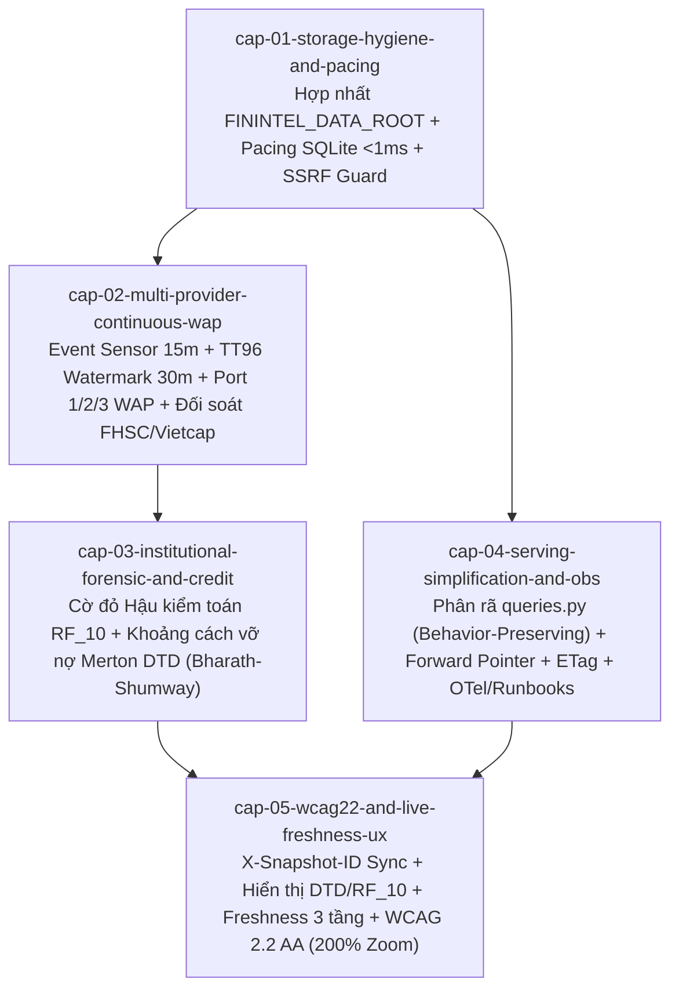

# Bản Đồ Năng Lực Hệ Thống FinIntel V2.0 (`spec/capability-map.md`)

> [!IMPORTANT]
> Đồ thị phụ thuộc giữa 5 năng lực dưới đây là **phi chu trình (DAG)**. Không một năng lực tầng dưới nào được phép import ngược từ năng lực tầng trên.

| Mã năng lực (`kebab-case`) | Trách nhiệm cốt lõi (1 câu) | Giải quyết bài toán nào | Phụ thuộc | Thứ tự build |
|---|---|---|---|---|
| `cap-01-storage-hygiene-and-pacing` | Hợp nhất đường dẫn `FININTEL_DATA_ROOT` chống split-brain kho dữ liệu, khóa nhịp gọi mạng liên tiến trình `< 1ms` qua SQLite (`<= 0.6 req/s`) và chặn SSRF DNS-rebinding / nén bom. | Tự động hóa & Tinh gọn Lakehouse | Không | Đợt 1 (`TASK-02..03`) |
| `cap-02-multi-provider-continuous-wap` | Vận hành tự động thu thập BCTC theo sự kiện (`15m`), quét TT96 theo watermark (`30m`, `< 2.85` ngày/685 mã), cập nhật an toàn chia tách Port 3 EOD / Port 1 pháp lý / Port 2 PDF CAS, đối soát chéo `FHSC ↔ Vietcap IQ` và bật `dagster-daemon` tự trị. | Tự động hóa thu thập WAP liên tục | `cap-01` | Đợt 2 (`TASK-04..06`) |
| `cap-03-institutional-forensic-and-credit` | Bổ sung quy tắc điều tra hậu kiểm toán `RF_10_POST_AUDIT_PROFIT_DOWNGRADE` (`severity = "HIGH"`) và chỉ báo cấu trúc thị trường Merton Distance-to-Default (`merton_dtd`, `equity_volatility_1y`, `naive_edf`) chuẩn PIT `0%` look-ahead cho Overlay và Walk-Forward Ablation độc lập. | Chiều sâu định lượng định chế | `cap-02` | Đợt 3 (`TASK-07..08`) |
| `cap-04-serving-simplification-and-obs` | Phân rã monolith `serving/queries.py` thành gói con `< 1.000` dòng/file giữ nguyên 100% hành vi, đồng bộ con trỏ tiến (`forward-only`), gắn `ETag` tổ hợp `<snap_id>:<port_digest>`, chuẩn hóa log/metrics/OTel và sổ tay vận hành `docs/runbooks/`. | Tinh gọn Serving & Observability | `cap-01` | Song hành (`TASK-01`, `TASK-09`) |
| `cap-05-wcag22-and-live-freshness-ux` | Đồng bộ nguyên tử `X-Snapshot-ID` trên Frontend, tích hợp thẻ hiển thị `Merton DTD` & `RF_10`, nâng cấp `frontend/src/components/ui/segmented-control.tsx` chuẩn WAI-ARIA, minh bạch hóa 3 mốc độ tươi dữ liệu và đạt `0` lỗi `critical/serious` chuẩn `WCAG 2.2 AA` ở `100%` & `200%` zoom (`320px–1440px`). | Trải nghiệm FinTech & WCAG 2.2 AA | `cap-03`, `cap-04` | Đợt 4 (`TASK-10..12`) |
