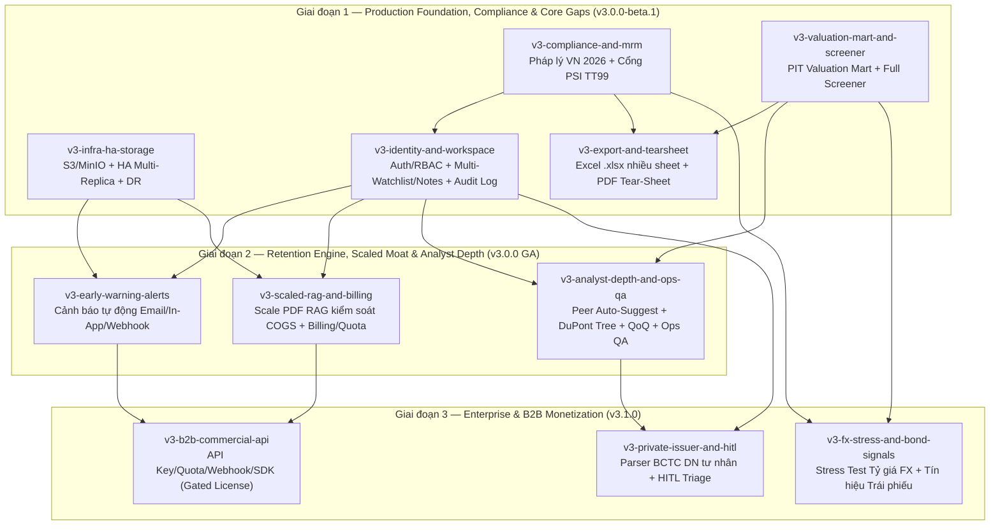

# Capability Map: FinIntel V3.0 — Production Go-Live & Commercial Competitiveness

> **Trạng thái:** Approved Phase 0 Map (Branch: `refactor/64-feature`)  
> **Tiền đề đã ship:** FinIntel V2.0 ([`spec/capability-map.md`](../capability-map.md), [`spec/SPEC-v2-autonomous-institutional-finintel.md`](../SPEC-v2-autonomous-institutional-finintel.md))  
> **Phạm vi nghiệp vụ khóa cứng:** Doanh nghiệp **phi tài chính (`CORPORATE`)** niêm yết/ĐKGD Việt Nam (`HOSE`, `HNX`, `UPCOM`), chuẩn kế toán VAS `TT200/2014 → TT99/2025`. Nhóm Ngân hàng / Chứng khoán / Bảo hiểm giữ ở *Out of Scope (Deferred to V4)*.

---

## 1. Đồ Thị Phụ Thuộc Phi Chu Trình (DAG — 11 Module / 3 Giai Đoạn)

> [!IMPORTANT]
> Đồ thị dưới đây là **DAG 1 chiều tuyệt đối (zero cycles)**. Mọi giao diện (API schema, DB contract, Parquet/DuckLake schema, event payload) nằm tại **biên giới của module cung cấp (provider module)** và phải giữ tương thích ngược trong suốt V3.x.



---

## 2. Bảng Đăng Ký Module & Phân Quyền Sở Hữu Tệp (Anti-Conflict Ownership)

| Wave | Module ID (`kebab-case`) | Spec File | Trách nhiệm cốt lõi | Phụ thuộc | Ranh giới thư mục sở hữu chính |
| :---: | :--- | :--- | :--- | :--- | :--- |
| **1A** | `v3-compliance-and-mrm` | [`SPEC-v3-compliance-and-mrm.md`](./SPEC-v3-compliance-and-mrm.md) | Chuẩn hóa nhãn pháp lý `R1–R5` (NĐ 88/2014), miễn trừ Luật CK 56/2024, contract đồng ý/xóa PII (Luật 91/2025), cổng kiểm định drift `PSI TT200→TT99` & shadow-scoring. | `—` | `docs/compliance/`, `src/finintel/ml/mrm_tt99.py`, `frontend/src/lib/compliance.ts`, `frontend/src/lib/domain-labels.ts` |
| **1A** | `v3-valuation-mart-and-screener` | [`SPEC-v3-valuation-mart-and-screener.md`](./SPEC-v3-valuation-mart-and-screener.md) | Materialize `pit_valuation_mart` trong DuckLake (`market_cap_vnd`, `pe_ttm`, `pb_ratio`), thêm `ocf_to_total_liabilities`, nâng cấp Screener đủ cột & bộ lọc tài chính/định giá/sàn/cụm/ngoại lai. | `—` | `src/finintel/analytics/valuation_mart.py`, `src/finintel/serving/queries/screener.py`, `frontend/src/app/screener/` |
| **1A** | `v3-infra-ha-storage` | [`SPEC-v3-infra-ha-storage.md`](./SPEC-v3-infra-ha-storage.md) | Hạ tầng **Cloud Free ($0/tháng)** phi thương mại: Vercel Hobby (FE) + Cloudflare Free/R2 (10 GB S3 Parquet/Backup) + OCI Always Free (`2 ARM OCPU / 12 GB RAM`, Singapore) hoặc Fallback Serverless (HF Spaces 16GB + Neon + Upstash + GitHub Actions), tách mạng nội bộ Dagster/Grafana. | `—` | `src/finintel/storage/object_store.py`, `docker-compose.free.yml`, `config/gateway/`, `docs/runbooks/free_cloud_deploy.md` |
| **1B** | `v3-identity-and-workspace` | [`SPEC-v3-identity-and-workspace.md`](./SPEC-v3-identity-and-workspace.md) | Auth/RBAC (`USER`, `RESEARCHER`, `INTERNAL_OPS`) trên Postgres `finintel_app` + Resend Free email, chuyển Multi-Watchlist + Analyst Notes + Saved Screens sang PostgreSQL, `user_audit_logs` & quyền xóa PII (Luật 91/2025). | `v3-compliance-and-mrm` | `src/finintel/auth/`, `src/finintel/workspace/`, `config/postgres-init/`, `frontend/src/app/auth/`, `frontend/src/app/watchlist/` |
| **1B** | `v3-export-and-tearsheet` | [`SPEC-v3-export-and-tearsheet.md`](./SPEC-v3-export-and-tearsheet.md) | Xuất Excel `.xlsx` nhiều sheet (BCTC + Chỉ số + DuPont + Cờ đỏ) và PDF Tear-Sheet 1–2 trang trung lập định lượng. | `v3-compliance-and-mrm`, `v3-valuation-mart-and-screener` | `src/finintel/serving/exports/`, `frontend/src/components/export/` |
| **2** | `v3-early-warning-alerts` | [`SPEC-v3-early-warning-alerts.md`](./SPEC-v3-early-warning-alerts.md) | Engine phát hiện biến động snapshot/sở GDCK & gửi cảnh báo tự động qua In-App, **Telegram Bot (miễn phí không giới hạn)**, **Resend Free Email** & Webhook cho Watchlist. | `v3-identity-and-workspace`, `v3-infra-ha-storage` | `src/finintel/alerts/`, `frontend/src/app/alerts/` |
| **2** | `v3-scaled-rag-and-billing` | [`SPEC-v3-scaled-rag-and-billing.md`](./SPEC-v3-scaled-rag-and-billing.md) | Mở rộng PDF RAG tự động lên Top 300–500 vốn hóa + 100% `R4/R5`/cờ đỏ theo định tuyến Text-first (`PyMuPDF`) → Gemini Free Tier có trần ngân sách + **Fair-Use Free Quota Guard** (bỏ cổng thanh toán thương mại). | `v3-identity-and-workspace`, `v3-infra-ha-storage` | `src/finintel/quota/`, `src/finintel/rag/batch_pipeline.py`, `frontend/src/components/quota/` |
| **2** | `v3-analyst-depth-and-ops-qa` | [`SPEC-v3-analyst-depth-and-ops-qa.md`](./SPEC-v3-analyst-depth-and-ops-qa.md) | Gợi ý 4 đối thủ cùng ngành ICB L3 (`/compare`), sơ đồ cây DuPont tương tác, `QoQ` cục bộ (cảnh báo mùa vụ), top Z-score ngoại lai đa biến, cổng Ops QA duyệt revision & đồng bộ vòng đời mã. | `v3-valuation-mart-and-screener`, `v3-identity-and-workspace` | `src/finintel/ops/`, `frontend/src/components/charts/DuPontTreeChart.tsx`, `frontend/src/app/compare/`, `frontend/src/app/ops/` |
| **3** | `v3-b2b-commercial-api` | [`SPEC-v3-b2b-commercial-api.md`](./SPEC-v3-b2b-commercial-api.md) | **Open Research & Developer API:** API Key cá nhân miễn phí, Rate-Limit chống spam bảo vệ hạ tầng free, Webhook rủi ro, Developer Portal & Python SDK (mặc định chỉ mở `read:derived_risk`, không thu phí). | `v3-early-warning-alerts`, `v3-scaled-rag-and-billing` | `src/finintel/api_gateway/`, `sdk/python/` |
| **3** | `v3-private-issuer-and-hitl` | [`SPEC-v3-private-issuer-and-hitl.md`](./SPEC-v3-private-issuer-and-hitl.md) | Bộ trích xuất bảng BCTC VAS đa cột (Excel/PDF) + luồng chấm điểm DN chưa niêm yết + hàng đợi phản hồi chuyên gia HITL False Positive Triage. | `v3-identity-and-workspace`, `v3-analyst-depth-and-ops-qa` | `src/finintel/private_credit/`, `src/finintel/hitl/`, `frontend/src/app/private-scoring/` |
| **3** | `v3-fx-stress-and-bond-signals` | [`SPEC-v3-fx-stress-and-bond-signals.md`](./SPEC-v3-fx-stress-and-bond-signals.md) | Mở rộng Stress Test IMF WP/15/216 thêm cú sốc Tỷ giá FX và tích hợp tín hiệu đáo hạn Trái phiếu doanh nghiệp / giao dịch nội bộ lớn. | `v3-compliance-and-mrm`, `v3-valuation-mart-and-screener` | `src/finintel/analytics/stress_fx.py`, `src/finintel/ports/bonds.py` |

---

## 3. Thứ Tự Thực Thi Song Song (Build Order) & Quy Ước Git Worktree

```text
Wave 1A (3 parallel agents): v3-compliance-and-mrm || v3-valuation-mart-and-screener || v3-infra-ha-storage
Wave 1B (2 parallel agents): v3-identity-and-workspace || v3-export-and-tearsheet
  ──► Milestone Tag: v3.0.0-beta.1 (Public Beta) + CHANGELOG.md
Wave 2  (3 parallel agents): v3-early-warning-alerts || v3-scaled-rag-and-billing || v3-analyst-depth-and-ops-qa
  ──► Milestone Tag: v3.0.0 (GA Commercial Launch) + CHANGELOG.md
Wave 3  (3 parallel agents): v3-b2b-commercial-api || v3-private-issuer-and-hitl || v3-fx-stress-and-bond-signals
  ──► Milestone Tag: v3.1.0 (Enterprise & B2B Platform) + CHANGELOG.md
```

### Quy Ước Git Bắt Buộc Cho Mọi Coding Agent (`git-workflow-and-versioning`)
1. **Worktree cô lập theo module (không sửa chung working copy):**
   ```powershell
   git worktree add ../finintel-<module-id> -b feat/<module-id> main
   ```
2. **Tách commit Behavior-Preserving vs Behavior-Changing:**
   - Cấm gộp `refactor:` với `feat:` trong cùng 1 commit (`CONSTRAINTS.md`).
   - Mục tiêu `~100–300` dòng/commit, tối đa `< 1.000` dòng/PR; mỗi commit phải xanh đủ cổng kiểm chứng của module trước khi mở commit tiếp.
3. **Điểm nối dùng chung (`api.py`, `schemas.py`, `definitions.py`, `AppShell.tsx`):**
   - Mỗi module mới **bắt buộc** đặt router FastAPI riêng (`APIRouter`) và mount 1 dòng vào `src/finintel/serving/api.py` (không tăng ròng quá `+10` dòng vào file legacy `> 1.000` LOC theo `CONSTRAINTS.md`).
   - Merge về `main` theo thứ tự hoàn thành trong từng Wave (short-lived branch `1–3` ngày), chạy lại `npm --prefix frontend run gen:api-types` sau khi router backend vào `main`, sau đó xóa nhánh và dọn worktree:
     ```powershell
     git worktree remove ../finintel-<module-id>
     git branch -d feat/<module-id>
     ```

---

## 4. Hạng Mục Cương Quyết Loại Bỏ Khỏi Toàn Bộ V3 (`Not Doing`)

Mọi coding agent **tuyệt đối không** tự ý thêm các hạng mục sau:
- `SMOTE` / dữ liệu tổng hợp cho bảng BCTC (`#48`)
- Nối `PCA` / `K-Means` / `IsolationForest` làm đầu vào cho `XGBoost` (`#22`, `#25`)
- Kiểm định `Benford's Law` $\chi^2$ trên BCTC tổng hợp đơn lẻ (`#59`)
- Thanh trượt `What-If` kéo độc lập chạy thẳng vào `XGBoost` (`#58`)
- `.fill_null(0)` hoặc nội suy tuyến tính số liệu BCTC (`#11`)
- Admin sửa tay đè trực tiếp con số BCTC trên DB (`#14`)
- Web UI chỉnh sửa Hyperparameter hoặc quy tắc gán nhãn Ground-Truth (`#44`, `#46`)
- LLM viết nhận định đầu tư / khuyến nghị mua bán tự do (`#60`)
- Web CRUD cho Taxonomy kế toán (`#8`) & Danh mục ngành/sàn (`#6`)
- Bảng giá khớp lệnh realtime & mạng xã hội chứng khoán; mở rộng Ngân hàng/Chứng khoán/Bảo hiểm (Deferred to V4).
