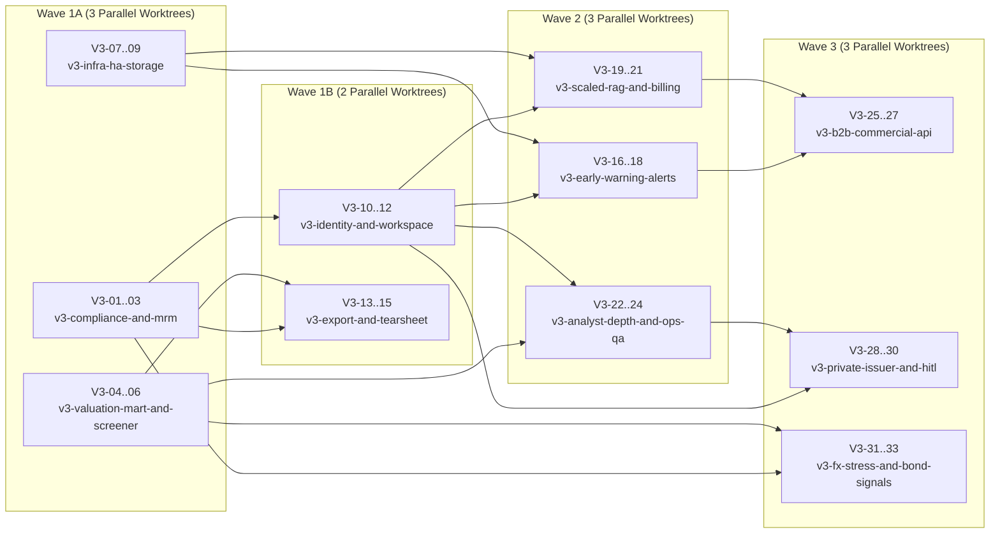

# Implementation Plan: FinIntel V3.0 — Free Cloud Production & Open Research Platform

Source specs:
- Capability Map: [`spec/v3/capability-map.md`](../spec/v3/capability-map.md)
- Module Specs: [`spec/v3/SPEC-v3-*.md`](../spec/v3/) (11 modules across 3 Phases / 4 Waves)
- Archived V2.0 Completed Plan: [`tasks/plan-v2.md`](./plan-v2.md)
- Actionable Task Checklist Target: [`tasks/todo.md`](./todo.md) (`33` atomic S/M tasks + `11` Checkpoints)

---

## 1. Overview

FinIntel V3.0 nâng cấp nền tảng FinIntel V2.0 (Lakehouse đọc-chỉ cho 685 doanh nghiệp phi tài chính niêm yết Việt Nam) thành một hệ thống **go-live production hoàn chỉnh ở mức chi phí `$0/tháng` (phi thương mại)**, giải quyết triệt để các khoảng trống còn thiếu từ kiểm toán 64 chức năng: tuân thủ pháp lý VN 2025–2026 & cổng drift `TT200 → TT99`, PIT Valuation Mart + Screener đa tiêu chí đầy đủ, hạ tầng Cloud Free (`OCI Always Free + Vercel Hobby + Cloudflare R2`), Auth/RBAC nội địa + Multi-Watchlist/Notes + Audit Log, Xuất `.xlsx`/PDF Tear-Sheet, Cảnh báo sớm tự động (Telegram/Resend/Webhook), Mở rộng PDF RAG kiểm soát hạn mức miễn phí, Sơ đồ cây DuPont + Peer Auto-Suggest + Ops QA bất biến, Open Research API/SDK, Thẩm định BCTC doanh nghiệp chưa niêm yết + HITL, và Stress Test Tỷ giá FX + Tín hiệu Trái phiếu doanh nghiệp.

---

## 2. Locked Architecture Decisions

1. **Hạ tầng Cloud Free (`$0/tháng`) — Phương án 1 (Khóa cứng):**
   - **Frontend (`Next.js 16`):** Vercel Hobby (`$0`, đúng điều khoản phi thương mại).
   - **DNS / WAF / Object Storage:** Cloudflare Free + **Cloudflare R2 Free (`10 GB`, `$0` egress)** cho DuckLake/Parquet backup & PDF lưu trữ.
   - **Compute + DB + Cache + Dagster:** **Oracle Cloud (OCI) Always Free Singapore (`2 ARM Ampere A1 OCPUs, 12 GB RAM, 200 GB Disk`)** chạy `docker-compose.free.yml` với `mem_limit` cứng `< 8 GB` (`Caddy` + `FastAPI` + `pgvector/pgvector:pg16` + `Valkey 8` + `Dagster Daemon`), giữ phương án dự phòng Zero-Card (`HF Spaces + Neon + Upstash + GitHub Actions`) qua cùng giao diện `object_store.py`.
   - **Email / Cảnh báo / LLM:** Resend Free (`3.000/tháng`, `100/ngày`) + Telegram Bot API (miễn phí không giới hạn) + Google AI Studio Gemini Free Tier (`Text-first PyMuPDF` + `daily_vision_page_cap = 150`).
2. **Mô hình Phi Thương Mại & RBAC 3 Vai Trò:**
   - Loại bỏ hoàn toàn cổng thanh toán trả phí (VNPay/PayOS/Stripe); thay bằng **Fair-Use Free Quota & Global Gemini Circuit Breaker** (`src/finintel/quota/`).
   - Chuẩn hóa đúng 3 vai trò trong toàn bộ hệ thống: `USER`, `RESEARCHER`, `INTERNAL_OPS`.
3. **Kỷ Luật Pháp Lý, Kế Toán & MRM (`CONSTRAINTS.md`):**
   - Gỡ sạch nhãn *"Bậc tín nhiệm / Xếp hạng tín nhiệm"* trên UI/Export (tuân thủ NĐ `88/2014/NĐ-CP`), gắn miễn trừ phi khuyến nghị (Luật CK `2019` sửa đổi Luật `56/2024/QH15`), lưu PII tập trung tại `finintel_app` có đồng ý & quyền xóa (Luật `91/2025/QH15`).
   - Giữ `api.py` và các file legacy `> 1.000` LOC tăng ròng `<= +10` dòng bằng cách tách 100% logic mới thành `APIRouter` độc lập (`src/finintel/auth/`, `workspace/`, `alerts/`, `quota/`, `ops/`, `api_gateway/`, `private_credit/`, `hitl/`, `serving/exports/`, `serving/routers/`).
   - Giữ **lazy-import** mọi thư viện thuộc group `platform` (`psycopg`, `redis`, `argon2`, `xlsxwriter`, `openpyxl`, `dagster`, `opentelemetry`) để CI `mvp-checks` (`--group ml --dev`) luôn xanh.
4. **Cơ Chế Thực Thi Song Song Cho Coding Agents (`git-workflow-and-versioning`):**
   - Mỗi module chạy trên `git worktree` cô lập (`git worktree add ../finintel-<module-id> -b feat/<module-id> refactor/64-feature` hoặc `main` sau khi merge chuẩn).
   - Tách bạch tuyệt đối commit `refactor:` (*Behavior-Preserving*) với `feat:` (*Behavior-Changing*).
   - Mỗi task giới hạn kích thước `S` hoặc `M` (`<= 5` tệp), hoàn tất trong 1 phiên tập trung và chạy đủ bộ lệnh kiểm chứng của module trước khi commit.

---

## 3. Dependency Graph & Parallel Execution Schedule

---

## 4. Ordered Task Index & Milestones

*(Chi tiết từng task, acceptance criteria, tệp chạm và lệnh kiểm chứng nằm đầy đủ trong [`tasks/todo.md`](./todo.md).)*

### Phase 1 — Wave 1A: Foundation, Compliance, Valuation Screener & Free Cloud Infra (3 luồng song song)
- **Stream 1A-1 (`v3-compliance-and-mrm`):** `V3-01` → `V3-02` → `V3-03` → *Checkpoint 1A-1*
- **Stream 1A-2 (`v3-valuation-mart-and-screener`):** `V3-04` → `V3-05` → `V3-06` → *Checkpoint 1A-2*
- **Stream 1A-3 (`v3-infra-ha-storage`):** `V3-07` → `V3-08` → `V3-09` → *Checkpoint 1A-3 & Wave 1A Merge Gate*

### Phase 1 — Wave 1B: Identity/Workspace & Institutional Exports (2 luồng song song)
- **Stream 1B-1 (`v3-identity-and-workspace`):** `V3-10` → `V3-11` → `V3-12` → *Checkpoint 1B-1*
- **Stream 1B-2 (`v3-export-and-tearsheet`):** `V3-13` → `V3-14` → `V3-15` → *Checkpoint 1B-2 & Phase 1 Milestone Gate*
- **Release Tag:** `v3.0.0-beta.1` (Public Beta trên OCI Always Free + Vercel Hobby + Cloudflare R2) + `CHANGELOG.md`

### Phase 2 — Wave 2: Retention Engine, Scaled Free RAG & Analyst Depth (3 luồng song song)
- **Stream 2-1 (`v3-early-warning-alerts`):** `V3-16` → `V3-17` → `V3-18` → *Checkpoint 2-1*
- **Stream 2-2 (`v3-scaled-rag-and-billing`):** `V3-19` → `V3-20` → `V3-21` → *Checkpoint 2-2*
- **Stream 2-3 (`v3-analyst-depth-and-ops-qa`):** `V3-22` → `V3-23` → `V3-24` → *Checkpoint 2-3 & Phase 2 Milestone Gate*
- **Release Tag:** `v3.0.0` (Free Cloud GA) + `CHANGELOG.md`

### Phase 3 — Wave 3: Open Research API, Private Credit Scoring & FX/Bond Risk (3 luồng song song)
- **Stream 3-1 (`v3-b2b-commercial-api`):** `V3-25` → `V3-26` → `V3-27` → *Checkpoint 3-1*
- **Stream 3-2 (`v3-private-issuer-and-hitl`):** `V3-28` → `V3-29` → `V3-30` → *Checkpoint 3-2*
- **Stream 3-3 (`v3-fx-stress-and-bond-signals`):** `V3-31` → `V3-32` → `V3-33` → *Checkpoint 3-3 & Final Release Gate*
- **Release Tag:** `v3.1.0` (Open Research & Credit Platform) + `CHANGELOG.md`

---

## 5. Parallelization Rules & Shared-File Coordination

| Nhóm tệp | Mức độ an toàn song song | Quy ước tránh xung đột merge |
|---|---|---|
| Các gói mới (`src/finintel/auth/`, `workspace/`, `alerts/`, `quota/`, `ops/`, `api_gateway/`, `private_credit/`, `hitl/`, `serving/exports/`) | **An toàn 100% song song** | Mỗi module sở hữu trọn thư mục riêng, không sửa ngang thư mục module khác. |
| SQL Migrations (`config/migrations/app_v3_00X_*.sql`) | **Đánh số cố định theo module** | `001` identity/workspace, `002` alerts, `003` quota, `004` ops QA, `005` API keys, `006` private credit/HITL — không bao giờ đụng tên file. |
| `src/finintel/serving/api.py` & `frontend/src/types/api.generated.ts` | **Cần phối hợp lúc merge** | Mỗi module chỉ thêm `<= 2` dòng `api.include_router(...)`; chạy `npm --prefix frontend run gen:api-types` sau khi merge backend vào nhánh tích hợp. |
| `pyproject.toml` & `uv.lock` | **Tuần tự khi merge** | Chỉ 3 task chạm dependency (`V3-10` `argon2-cffi`, `V3-13` `xlsxwriter`, `V3-28` `openpyxl`); luôn ghim cứng `==` trong group `platform` và regenerate `uv.lock` lúc merge. |

---

## 6. Risks and Mitigations

| Risk | Impact | Mitigation |
|---|---|---|
| OCI Always Free khu vực Singapore hết dung lượng ARM A1 lúc đăng ký | Medium | `V3-07`/`V3-09` thiết kế `object_store.py` (Cloudflare R2) + workflow `.github/workflows/free-etl-fallback.yml` để chạy ngay Phương án 2 (Vercel + HF Spaces 16GB + Neon + Upstash) mà không sửa code nghiệp vụ. |
| Cháy hạn mức miễn phí Gemini / Resend / R2 khi mở công khai | High | `V3-19`/`V3-20` khóa cứng `daily_vision_page_cap = 150`, Global Gemini Circuit Breaker ở `85%`, ưu tiên Telegram (không giới hạn) cho instant alerts và chỉ dùng Resend cho auth + Daily Digest (`< 80/ngày`). |
| Xung đột merge giữa nhiều agent song song trên `api.py` hoặc `screener.py` | Medium | Tách mọi route mới ra `APIRouter` riêng; chỉ ghép Wave sau khi Wave trước xanh đủ `CONSTRAINTS.md`. |
| Phá CI `mvp-checks` (`--group ml --dev`) do import trực tiếp thư viện `platform` | High | Mọi module mới giữ lazy-import cho `psycopg`, `redis`, `argon2`, `xlsxwriter`, `openpyxl` và có test verify chạy offline không cần Postgres/Valkey. |
| Vi phạm giới hạn `< 1.000` LOC trên `serving/queries/screener.py` hoặc `frontend/src/*` | Medium | Chạy `scripts/check_constraints.py` trên mọi task; tách helper nhỏ (`_screener_filters.py`, sub-components) ngay khi file chạm `750` LOC. |

---

## 7. Open Questions (Non-Blocking cho Wave 1A)

1. Nhánh tích hợp chính cho V3: merge các commit hiện tại của `refactor/64-feature` về `main` trước khi mở các worktree Wave 1A, hay dùng `refactor/64-feature` làm nhánh tích hợp chung cho toàn bộ V3 rồi mới merge 1 lần về `main`? *(Khuyến nghị theo `git-workflow-and-versioning`: **merge `refactor/64-feature` về `main` trước** để `main` luôn có code & spec mới nhất, rồi tách short-lived worktrees `feat/v3-*` trực tiếp từ `main`.)*
2. Xác nhận khởi chạy **Wave 1A** tuần tự từng module hay chạy song song **3 agent worktree cùng lúc** (bằng `/teamwork` hoặc `swarm`) sau khi bạn duyệt plan này.
